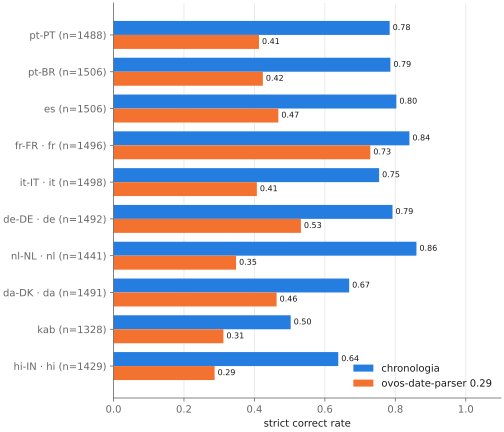

# Benchmarking chronologia against other date parsers

<!-- agent-hint
covers: how the differential benchmark against dateparser and dateutil and the cross-view harness run and what their numbers mean
source: tools/plot_benchmarks.py, docs/benchmarks/odp_vs_chronologia.json, benchmark/run.py, benchmark/adapter.py, benchmark/crossview.py, benchmark/SCOREBOARD.md
generated: no
verify: for f in $(grep '^python benchmark/run.py' docs/benchmarks.md | grep -o -- '--[a-z-]*' | sort -u); do .venv/bin/python benchmark/run.py --help | grep -q -- "$f" || exit 1; done && .venv/bin/python -m benchmark.crossview --help | grep -q disagree && for f in $(sed -n '/^## Comparing two trees/,/^## Caveats/p' docs/benchmarks.md | grep -o -- '--[a-z-]*' | sort -u); do (.venv/bin/python -m benchmark.crossview run --help; .venv/bin/python -m benchmark.crossview diff --help; .venv/bin/python -m benchmark.crossview disagree --help) | grep -q -- "$f" || exit 1; done && .venv/bin/python -c 'exec("import os,re\nt=open(\"docs/benchmarks.md\").read()\nfor q in set(re.findall(r\"\\x60((?:benchmark|test|examples)/[^\\x60<>*:]+)\\x60\",t)): assert os.path.exists(q.rstrip(\"/\")),q\nassert os.path.exists(\"benchmark/SCOREBOARD.md\")\n")'
see: docs/extraction.md, docs/transparency.md
-->

This page is for anyone who has never touched this benchmark before. It explains, in plain language: what gets measured, why, how to run it yourself, and what the numbers do *not* tell you.

## What the benchmark measures

chronologia is one of several Python libraries that turn a sentence like `"in three weeks"` or `"le 5 juin 2027"` into a computer-usable date. Two well-known alternatives are:

- [`dateparser`](https://dateparser.readthedocs.io/), a general-purpose, many-language date-string parser.
- [`python-dateutil`](https://dateutil.readthedocs.io/)'s `parser.parse`, a flexible parser mostly aimed at English-shaped date *strings* (`"2027-06-05"`, `"June 5, 2027"`), with only limited fuzzy/free-text support.

The benchmark in `benchmark/` runs all three engines over the **same** set of natural-language sentences and checks whether each engine's answer matches a human-derived "gold" answer. It reports one thing only: **how often each engine gets the exact date right**, broken down by language.

This is a *differential* benchmark, not a certification: nothing here blocks a merge or fails CI. The project's house rule is "benchmark, don't assert". We measure and report all results, including cases where a competitor wins. We write no test that insists chronologia must win.

## Where the gold answers come from

The gold set is **not** invented for this benchmark. Each run pulls the corpus live from chronologia's own natural-language test corpora under `test/nl_corpus_<lang>/`. These are the hand-written `(sentence, expected_date)` pairs that the project's own test suite asserts. A human derived those expectations by independent date arithmetic (see each corpus's `_corpus.py` module docstring). No engine produced them. That independence is what makes the comparison meaningful: nobody is grading an engine against its own answer key.

The corpus is still chronologia's own. The sentences exercise the phrasings chronologia set out to read, and nobody sampled them independently of it. So the comparison is self-selected in chronologia's favour. The score should be read as "how chronologia does on the phrasings it was built for," not a neutral, third-party benchmark.

`benchmark/adapter.py` does the pulling. It uses pytest's own collection machinery to walk every `test/nl_corpus_*/` package. It gathers every parametrized test case shaped `(text, expected)` where `expected` is a real `date` or `datetime` object. The type check filters out other shapes, such as the `(text, expected_timedelta)` cases of `extract_duration`. No language is special-cased by name. Add an `nl_corpus_xx/` package to the test suite and the benchmark picks its cases up on the next run.

This pulls every gold case from the corpora that use the `text,expected` convention. The adapter does not walk corpora that use other parametrize shapes, such as semantic-parity `(xx_text, en_text)` pairs (see Caveats). The count grows automatically as corpora are added.

## How scoring works

Every gold case is `(language, sentence, expected_date, anchor_datetime)`. `anchor_datetime` is the fixed anchor of the corpus (`ANCHOR`, a specific Tuesday at 13:04). Relative phrases like "in three weeks" resolve against it. So results are 100% reproducible, no wall-clock dependency.

For each case, each engine gets exactly one of three outcomes:

- **exact**: the engine's answer's *date* equals the gold date.
- **no-parse**: the engine returned nothing at all.
- **wrong**: the engine returned some date, but it isn't the gold date.

The tools `dateparser` and `dateutil` both return a plain `datetime`, a single instant. The function `extract_timespan` of chronologia returns a `DateSpan`: the whole width of time a phrase names. The phrase `"june 2027"` is a month wide, not a single second. Per the project's house rule, chronologia is graded on `span.start.date()` so the three engines are compared on the same axis. This *understates* what chronologia gives you beyond that: the span's end, its resolution tag and non-Gregorian calendar metadata. The competitors have no equivalent to credit.

## Running it yourself

```bash
# full run over every corpus
python benchmark/run.py --out benchmark/SCOREBOARD.md

# restrict to a few languages while iterating
python benchmark/run.py --langs en de ar

# fast, deterministic smoke sample (what the committed test runs)
python benchmark/run.py --sample 50 --seed 0
```

`benchmark/SCOREBOARD.md` is a dated snapshot of one full run. Its header gives the date of that run. No test or CI step checks its numbers, so they can differ from the current code. This page quotes no number from it. To get current numbers, run the first command above.

## Against ovos-date-parser

This comparison scores chronologia and ovos-date-parser 0.29 on the same outside date benchmark. The benchmark rows come from the bench classes in `tools/bench/data/date_*.jsonl` of the agent workspace, not from the corpora of this repository. A row is correct only when the reader gives the gold value. The `source` key of the result file names the chronologia commit and the benchmark version that the numbers come from.

`tools/plot_benchmarks.py` makes the figure, the table and `benchmarks/odp_vs_chronologia.json`. Its input is the summary TSV `knowledge/wiki/audits/chronologia/vs-odp029/table.tsv` in the agent workspace. That file scores chronologia at commit d202532a. To make the files again, run this command from the root of this repository:

```bash
python tools/plot_benchmarks.py ~/AgentWorkspaces/knowledge/wiki/audits/chronologia/vs-odp029/table.tsv
```

The Bench rows column names the rows that measure each leader tag. A bench locale with no region tag has rows in the general language, with no regional variety. The Locale data column names the folder in `chronologia/locale/` that reads the rows. The es rows have no region tag, so they do not measure es-CO.

<!-- odp-table:start -->
<picture>
  <source media="(prefers-color-scheme: dark)" srcset="img/odp_vs_chronologia-dark.svg">
  
</picture>

| Leader tag | Bench rows | Locale data | Rows | chronologia | ovos-date-parser 0.29 | Ready |
|:---|:---|:---|---:|---:|---:|:---|
| pt-PT | pt-PT | pt | 1488 | 0.784 | 0.413 | no |
| pt-BR | pt-BR | pt | 1506 | 0.786 | 0.424 | no |
| es-CO | none | es | 0 | not measured | not measured | not measured |
|  | es (rows with no region tag) | es | 1506 | 0.803 | 0.468 | no |
| fr-FR | fr (rows with no region tag) | fr | 1496 | 0.840 | 0.729 | no |
| it-IT | it (rows with no region tag) | it | 1498 | 0.754 | 0.407 | no |
| de-DE | de (rows with no region tag) | de | 1492 | 0.792 | 0.532 | no |
| nl-NL | nl (rows with no region tag) | nl | 1441 | 0.860 | 0.348 | no |
| da-DK | da (rows with no region tag) | da | 1491 | 0.669 | 0.463 | no |
| kab | kab | kab | 1328 | 0.503 | 0.312 | no |
| hi-IN | hi (rows with no region tag) | hi | 1429 | 0.638 | 0.287 | no |
| bn-IN | none | none | 0 | not measured | not measured | not measured |
| mwr | none | none | 0 | not measured | not measured | not measured |
<!-- odp-table:end -->

A higher total rate does not make a locale ready. The ready flag needs a rate at least as high on every bench class. [languages/index.md](languages/index.md#support-table) explains the flag. es-CO, bn-IN and mwr have no bench rows.

## Comparing two trees

The cross-view harness answers a different question: did my change move any answer? It runs every phrase-like string of every `test/nl_corpus_<lang>/` package through `extract_timespan`, `extract_candidates`, `extract_recurrence` and `extract_event`. It also runs generated grids of ordinal, impossible-date and bound phrases. Each phrase runs in default mode and in `impossible="raise"` mode, at two fixed anchors. One TSV row per call holds the normalised result and the call time in microseconds.

Run it once on the base tree and once on your branch, then compare the two files. The flag `--chunk i/n` splits the work, and the flag `--lang en,pt` limits it to some languages:

```bash
for i in 0 1 2 3; do python -m benchmark.crossview run base.$i.tsv --chunk $i/4; done
python -m benchmark.crossview diff --base base.?.tsv --head head.?.tsv
python -m benchmark.crossview disagree head.?.tsv
```

The command `run` prints the number of phrases and rows it wrote. The command `diff` prints the row counts and the changed rows. It groups the changed rows by view, mode and kind of change. It also prints the median and p95 time per call of each side.

The command `diff` exits with 1 when a row changed, is missing or appears twice. The command `disagree` lists the phrases for which two views of one tree give contradictory readings. For example, `extract_candidates` reads a phrase that `extract_timespan` returns as `None`.

## Caveats

- **This is not a certification**. A benchmark score is a snapshot of one gold set on one day. It says nothing about phrases nobody has written a test for yet.
- **The playing field isn't perfectly level.** dateparser and dateutil are general-purpose parsers not designed around chronologia's span-native contract or its non-Gregorian/eras/recurrence features. They are being asked to do a narrower job than they're built for (a single left-edge date) and are graded only on that narrower job.
- **Business-day cases are graded without jurisdiction context.** chronologia's `extract_timespan` accepts an optional `jurisdiction` (an ISO country code) to make "in 3 working days" holiday-aware. The benchmark calls it without one. A handful of German `test_nl_business_days.py` cases assume a specific jurisdiction's holiday calendar in their gold values. They score as "wrong" here. They pass in chronologia's own test suite, which passes the jurisdiction. This is a known adapter limitation, not an engine bug.
- **Not every corpus is walked**. Corpora that only carry semantic-parity blocks (`(xx_text, en_text)` parametrize shape) rather than `(text, expected_date)` cases are not pulled into the gold set. Languages with zero rows in the scoreboard simply have no `text,expected`-shaped cases, not zero support.
- **Where a competitor wins, the table shows it**. The per-language table in `benchmark/SCOREBOARD.md` lists the three engines side by side. That table is a dated snapshot.

## Related projects

See the [chronologia README](../README.md) for the project's own description and links to sibling repos in the org.

---
[← Design](design.md) · [Home](index.md) · [Transparency: how correctness is checked →](transparency.md)
