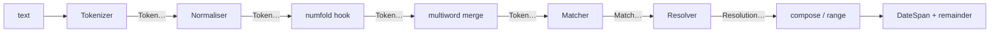

# Reading dates written by humans

<!-- agent-hint
covers: how extract_timespan turns a phrase into a span, how locales declare their vocabulary, what a locale refuses and how impossible dates and character offsets work
source: chronologia/extract/, chronologia/extract/impossible.py, chronologia/locale/
generated: no
verify: .venv/bin/python -c 'exec("import ast,io,re,sys,contextlib as c\np=sys.argv[1];t=open(p).read();ns={};n=bad=0\nfor b in re.findall(r\"\\x60\\x60\\x60python\\n(.*?)\\x60\\x60\\x60\",t,re.S):\n    if \"# doctest: skip\" in b: continue\n    L=b.split(\"\\n\")\n    for s in ast.parse(b).body:\n        o=io.StringIO()\n        with c.redirect_stdout(o): exec(compile(ast.Module([s],[]),p,\"exec\"),ns)\n        n+=isinstance(s,ast.Assert)\n        m=re.match(r\"^\\s*print\\(.*\\)\\s+# (.+)$\",L[s.end_lineno-1]) if isinstance(s,ast.Expr) and s.lineno==s.end_lineno else None\n        if m: n+=1; bad|=m[1].strip()!=o.getvalue().strip()\nsys.exit(bad or n==0)\n")' docs/extraction.md
see: docs/adding-a-language.md, docs/rulings.md, docs/languages/index.md
-->

This module has one job: **turn "the 15th of Ramadan 1446" into a span**. A person writes a date as a phrase. The phrase has an ordinal, a month name from whichever calendar the writer thinks in, and a year. `extract_timespan` turns it into the exact stretch of time it names.

```python
from chronologia import extract_timespan
from datetime import datetime

anchor = datetime(2024, 1, 1)   # what "now" means for relative phrases

span, remainder = extract_timespan("the 15th of Ramadan 1446", "en", anchor)
print(span.start_datetime.date())   # 2025-03-15
print(remainder)                    # the
```

The 15th of the Islamic month Ramadan in the Hijri year 1446 is the 15th of March 2025, computed, not looked up. The Islamic month name is read straight from the English vocabulary. You do not have to tell the library which calendar the phrase is in.

## What comes back

`extract_timespan(text, lang, anchor)` returns either `None` (nothing matched) or a `DateSpanResult`, a named 2-tuple of `(span, remainder)`. You can unpack it (`span, remainder = extract_timespan(...)`), index it (`result[0]`), or read the named fields (`result.span`, `result.remainder`), all three access the same two values:

- **`span`** is a [`DateSpan`](getting-started.md), a half-open interval, *not* a single instant. A phrase names a stretch of time, and the span's **width** is that stretch. "June 2027" is a month wide. "3 pm" is a minute wide. This is the whole reason the function exists: it never invents a precision the speaker did not give.
- **`remainder`** is the leftover text the parse did not consume, the words around the date. So a caller can see what was and was not a date.

## Supported languages

Pass any of these ISO codes as the `lang` argument. Each corresponds to a vocabulary bundle under `chronologia/locale/<code>/`. Asking for a code with no bundle raises `NotImplementedError` naming the missing locale.

| | | | | |
|---|---|---|---|---|
| `an` Aragonese | `ar` Arabic | `ast` Asturian | `az` Azerbaijani | `bg` Bulgarian |
| `ca` Catalan | `cs` Czech | `cy` Welsh | `da` Danish | `de` German |
| `el` Greek | `en` English | `eo` Esperanto | `es` Spanish | `et` Estonian |
| `eu` Basque | `fa` Persian | `fi` Finnish | `fil` Filipino | `fr` French |
| `fy` West Frisian | `ga` Irish | `gl` Galician | `he` Hebrew | `hi` Hindi |
| `hr` Croatian | `hu` Hungarian | `hy` Armenian | `id` Indonesian | `is` Icelandic |
| `it` Italian | `ka` Georgian | `kab` Kabyle | `lt` Lithuanian | `lv` Latvian |
| `mk` Macedonian | `ms` Malay | `mt` Maltese | `mwl` Mirandese | `nb` Norwegian Bokmål |
| `nl` Dutch | `nn` Norwegian Nynorsk | `oc` Occitan | `pl` Polish | `pt` Portuguese |
| `ro` Romanian | `ru` Russian | `sk` Slovak | `sl` Slovenian | `sq` Albanian |
| `sr` Serbian | `sv` Swedish | `tr` Turkish | `uk` Ukrainian | `vi` Vietnamese |

English carries the widest grammar. Coverage of the more specialised constructions (regnal years, classical Roman date formulas, deep-time eras) varies by language and is noted where it applies below.

## When a language declines a phrase

A language code in that table does not promise that every construction on this page works in that language. A locale ships a construction only where the surface form is **attested**. A dictionary, a language authority, a style guide or a native speaker's confirmation must say that this is how people say it. Where the sources conflict, or none of them names a form, the locale ships nothing.

The phrase then returns `None`. If part of the phrase is a construction that the locale knows, the call returns a narrower span. The unreadable words stay in the remainder. Either way that is a deliberate answer, not a hole someone forgot to fill.

The same reasoning governs the rest of the library: **a wrong span is worse than no span**. A caller cannot tell a guessed date from a computed date. Suppose a Macedonian locale invented a minutes-to-the-hour form because most of Europe has one. Then "five to nine" would come back as a confident 08:55 in a language that counts only forward from the hour.

The scheduler on the other end would act on it. Refusing costs the caller one phrase. Guessing costs them a wrong appointment they have no way to detect.

Refusals are not blanket. They are as narrow as the evidence, and the rest of the language keeps working around them. Macedonian reads clock times fine, it just reads them the additive way its own style guides document:

```python
from chronologia import extract_timespan
from datetime import datetime

anchor = datetime(2017, 6, 27, 13, 4)

span, _ = extract_timespan("девет и педесет", "mk", anchor)   # "nine and fifty"
print(span.start_datetime)  # 2017-06-27 21:50:00

# a minutes-to form
print(extract_timespan("без пет девет", "mk", anchor))  # None
```

Serbian shows the other shape of a refusal: one *word* declines, while a synonym answers. *Nedelja* names both Sunday and the week. The sources disagree about which sense dominates in the genitive that "last" and "next" use. *Sedmica* is unambiguously the week. So it carries the reading and *nedelja* declines rather than pick a side:

```python
span, _ = extract_timespan("prošle sedmice", "sr", anchor)   # "last week"
print(span.start_datetime.date())   # 2017-06-19

print(extract_timespan("prošle nedelje", "sr", anchor))  # None
```

The same veto runs through the duration reader, for the same reason: a count before *nedelja* could only mean weeks, since nobody counts individual Sundays. But the week sense of that word is the unsourced one. Answering "two Sundays" would be worse than answering nothing:

```python
from chronologia import extract_duration

print(extract_duration("dve sedmice", "sr").duration.days)   # 14
print(extract_duration("dve nedelje", "sr"))                 # None
```

Georgian has the same collision in a sharper form. *კვირა* is both Sunday and the week. The two senses share one declension, and no source separates them. So Georgian ships no week duration unit at all. A count before the word vetoes the weekday reading rather than hand a caller who asked for a duration one specific day. Maltese has no sourced word for the day before yesterday, and CLDR carries no such field.

So that one named day is absent, while "the day after tomorrow" answers normally. Several locales ship no day-period bands, which means no "morning" or "evening" spans. The reference data defines no boundaries for them. Clock times for a cultural convention would be plausible fiction, and this library refuses to produce it.

### Telling a refusal from a bug

Both look identical from the caller's side: `None`, or a span with words left in the remainder. Three checks separate them.

**Does the phrase's construction exist in that locale at all**? Look in `chronologia/locale/<code>/` for the vocabulary the phrase needs. A minutes-to clock needs `clock_dir_to.voc`. A day-before-yesterday needs `named_day_-2.voc`.

If the file is not there, the omission is deliberate. The neighbouring files usually carry a header comment saying which source was consulted and what it failed to establish. Those headers are where the reason lives.

**Does the same phrase work in a language you know**? If English or Spanish reads the construction and yours does not, the gap is per-locale. It is either a deliberate refusal or a missing translation. The vocabulary files tell you which.

**Does `explain` show the construction firing and losing**? Suppose the machinery matched something and then discarded it (see [Seeing why a parse landed](#seeing-why-a-parse-landed)). Then the vocabulary is present and the behaviour is a ranking question. That is a bug worth reporting, not a refusal.

What to do with each: a **deliberate refusal** is worth reporting only if you can bring the evidence it lacks. That evidence is a dictionary entry, a grammar, a style guide, or your own confirmation as a native speaker. That turns an unsourced form into a sourced one, and the locale can then ship it. A **missing translation** is a straightforward contribution, and [adding-a-language.md](adding-a-language.md) walks through it. A **wrong answer** is a span that comes back confidently wrong. It is the highest-value report of all, because the whole design exists to prevent this failure.

## What goes in, and what raises

Every extractor, `extract_timespan`, `extract_timespans`, `extract_duration`, `extract_recurrence`, `extract_candidates`, `extract_event`, takes text as a `str`. Handing one anything else is a mistake in the calling program. It raises a `TypeError` naming the contract rather than letting an internal error surface further down. Text the library cannot read is a different matter. The empty string, a whitespace run and a sentence with no date in it all return the empty result of the extractor. That result is `None` for the extractors that return a single value, and an empty list for the ones that return several.

```python
from chronologia import extract_timespan

assert extract_timespan("", "en") is None
assert extract_timespan("the quick brown fox", "en") is None

try:
    extract_timespan(None, "en")
except TypeError as err:
    print(err)          # extract_timespan() reads text: expected str, ...
```

```python
from chronologia import extract_timespan
from datetime import datetime

june, _ = extract_timespan("june 2027", "en", datetime(2024, 1, 1))
print(june.width, "|", june.resolution.name)   # 30 days, 0:00:00 | MONTH

three_pm, _ = extract_timespan("3 pm", "en", datetime(2024, 1, 1))
print(three_pm.width)                           # 0:01:00
```

## The anchor

Relative phrases ("in three days", "next winter", "last tuesday") only mean something relative to a moment. That moment is the `anchor`. Pass the moment that your caller treats as the present. It defaults to the wall clock.

```python
from chronologia import extract_timespan
from datetime import datetime

anchor = datetime(2017, 6, 27, 13, 4)   # a Tuesday

soon, _ = extract_timespan("in three days", "en", anchor)
print(soon.start_datetime)   # 2017-06-30 13:04:00

winter, _ = extract_timespan("next winter", "en", anchor)
print(winter.start_datetime.date())   # 2017-12-01
```

A season is read against the season the anchor falls in, not against the calendar year. Someone who says "last summer" in July means the summer that has finished, never the one they are standing in. "Next summer" is the one after that. The December-starting winter runs into the new year, so in January the winter in progress is the one that began the previous December:

```python
from chronologia import extract_timespan
from datetime import datetime

july = datetime(2017, 7, 15)
assert extract_timespan("last summer", "en", july).span.start.year == 2016
assert extract_timespan("this summer", "en", july).span.start.year == 2017
assert extract_timespan("next summer", "en", july).span.start.year == 2018

january = datetime(2018, 1, 15)
assert extract_timespan("last winter", "en", january).span.start.year == 2016
assert extract_timespan("this winter", "en", january).span.start.year == 2017
assert extract_timespan("next winter", "en", january).span.start.year == 2018
```

A range framed with "from A to B" or "between A and B" runs from the start of the left endpoint to the end of the right endpoint:

```python
from chronologia import extract_timespan
from datetime import datetime

span, _ = extract_timespan("from june 5th to june 12th", "en",
                           datetime(2017, 6, 27))
print(span.start_datetime.date(), "->", span.end_datetime.date())  # 2018-06-05 -> 2018-06-13
```

(June 5-12 is already past the June-27 anchor, so it rolls to the next year, the engine prefers the future for bare calendar dates.)

Both endpoints resolve in the **same** frame: the future preference is applied to the range as a whole, never to one endpoint alone. So a range that *straddles* the anchor keeps both edges in the current cycle. The left endpoint does not leap a year ahead of the right. Spoken on July 22, "from july 20 to july 25" is this year's July 20-25, not next year's.

A cross-year span like "from december 28 to january 3" simply rolls the *end* into the following year so it never inverts. Any endpoint that resolves to a date works. Bare dates, dates with years and holidays ("from christmas to new year's day") all compose, in dash form too ("july 20 - july 25").

**The month may be named once for the pair**. These all read as 5-12 June: "del 5 al 12 de junio" (es), "du 5 au 12 juin" (fr), "dal 5 al 12 giugno" (it), "с 5 по 12 июня" (ru) and the English "June 5 to 12". The endpoint that carries only a bare day is read through the words of its partner, so the day is never dropped. This is one rule over the token stream.

The partner's slice is rebuilt with its numeral replaced. So the language's own glue ("de", "di") and word order come along without a per-locale spelling. Two bare numbers lend each other nothing. This is why "from 9 to 5" is still a working day and "quarter to five" is still a clock.

**The "until" word of a language closes a range and also opens one**. English "until" is the open marker ("until friday"). It is also a `to` connector ("from june 5 until june 12"). Every language's `marker_until` surface does the same job. So Persian "از ۵ ژوئن تا ۱۲ ژوئن", Indonesian "5 Juni sampai 12 Juni" and Malay "12 Jun hingga 20 Jun" are closed ranges.

They are not open ranges that run to the anchor. The named limit is included. This matches the open-range convention below. These sources state it for those languages: Ожегов s.v. «по» II.1 ("Отпуск по воскресенье"), KBBI s.v. *sampai* sense 6 ("perjanjian itu berlaku sampai tahun depan") and Kamus Dewan s.v. *hingga*.

**Open-ended ranges** name a single endpoint and pin the other edge to the anchor. The named endpoint keeps the closed-range convention. The *until* endpoint contributes its end, and the span includes it in full, like the right endpoint of "from A to B". The *since* endpoint contributes its start:

```python
extract_timespan("until friday", "en", datetime(2017, 6, 27, 13, 4))[0]
# [2017-06-27 13:04, 2017-07-01)  -- now through the whole of Friday
extract_timespan("since 2010", "en", datetime(2017, 6, 27, 13, 4))[0]
# [2010-01-01, 2017-06-27 13:04)  -- start of 2010 up to now
```

The `until`/`through` (open start) and `since` (open end) surfaces are per-language range markers. "bis freitag" / "seit 2010" (de), "jusqu'à vendredi" / "depuis 2010" (fr), "até sexta-feira" / "desde 2010" (pt) and "hasta viernes" / "desde 2010" (es) behave the same way.

### Marker positionality

*Where* a marker sits relative to its date is a per-language fact. `lang.json` declares it as `positions`. This is a role → position map over the markers `until`, `since` and `for`. Three positions are recognised. The default, when a role is undeclared, is `pre`:

- **`pre`**: the marker **leads** its date ("until friday", German "bis freitag", French "jusqu'à vendredi"). The English/Romance default.
- **`post`**: the marker is a **postposed bound word trailing** its date, the native order for many agglutinative languages: Finnish "perjantai asti" / "2020 saakka", Turkish "cumaya kadar", Basque "ostirala arte", Azerbaijani "2020 qədər", Hungarian "2010 óta" (since). The engine scans for the marker after the resolved endpoint.
- **`affix`**: the marker is a **bound suffix fused onto the date's final surface token**, with no space or separator. Hungarian's until case suffix `-ig` is the canonical case: "péntekig" = "péntek" (Friday) + "ig", "hétfőig", "2026-ig". The engine splits a known affix off the last token and re-resolves the stripped host. It accepts the split **only when the host without the affix parses as a date**. So a common word ending in the same letters ("nadrágig" = "trousers-until") never misfires. A bare affix with no host is never a range.

The `positions` fact drives which readings the engine attempts. A language declares `until: affix` or `since: post` alongside the ordinary `marker_until` / `marker_since` vocabulary that lists the surface. The postposed open-range markers (Finnish `asti`/`saakka`, Turkish `kadar`, Basque `arte`, Azerbaijani `qədər`) and the Hungarian `-ig` affix and `óta` postposition resolve natively.

Basque `arte` is genuinely ambiguous, it means both "until" and "art". So it only reads as the range marker when the head parses as a date endpoint. A bare "arte" is never a range. Turkish/Azerbaijani add a dative suffix to the date noun in careful speech, which is a downstream morphology concern. The engine reads the bare head.

## A lone spoken hour

An hour from 1 to 12 with no am/pm word and no part of the day takes the next of its two twelve-hour readings at or after the anchor. "at 8" said at 13:04 is 20:00 the same day, not 08:00 tomorrow. A digit clock `h:mm` with an hour from 1 to 11 and no leading zero reads the same way. Speech recognition writes a spoken "eight thirty" as "8:30": "at 8:30" is 20:30.

"Today" names no part of the day, so "at 3:30 today" said at 15:00 is 15:30. An hour keeps its written value when a day word or a part of the day goes with it. It also keeps its value with a meridiem, a leading zero ("08:30"), the hour 12, the letter "h" or an hour from 13 to 23. A morning or evening word that the language lists for a half of the day decides the half when it stands beside the clock. This holds also when the reader does not join the word to the clock:

Dutch "om 8:00 's ochtends" is 08:00 and "om 8:00 's avonds" is 20:00. Only a clock word ("uur"), the word that opens the clock ("om") or an article may stand between them. So Spanish "a las 6:30 que no quiero llegar tarde" ("late") said at 23:00 is 06:30. Spanish, Portuguese and Galician "tarde" is also the adverb "late", so before the clock and after another word of its clause it decides nothing: "llego tarde a las 6:30" is 06:30, while "tarde a las 4:30" is 16:30.

A part of the day after a digit clock joins the clock as it joins a spoken hour: Spanish "a las 6:30 de la tarde" said at 13:04 is 18:30. "a las 6:30 de la mañana" is 06:30 the next day. This holds in every language, for `extract_timespan`, `extract_timespans` and the top `extract_candidates` reading. A recurrence pin names an hour of the day, so `extract_recurrence("daily at 7")` stays `BYHOUR=7`.

```python
from datetime import datetime
from chronologia import extract_timespan

anchor = datetime(2017, 6, 27, 13, 4)   # a Tuesday afternoon

assert extract_timespan("at 8", "en", anchor).span.start.datetime() == datetime(2017, 6, 27, 20, 0)
assert extract_timespan("tomorrow at 8", "en", anchor).span.start.datetime() == datetime(2017, 6, 28, 8, 0)
assert extract_timespan("at 8 am", "en", anchor).span.start.datetime() == datetime(2017, 6, 28, 8, 0)
assert extract_timespan("at 8:30", "en", anchor).span.start.datetime() == datetime(2017, 6, 27, 20, 30)
assert extract_timespan("at 08:30", "en", anchor).span.start.datetime() == datetime(2017, 6, 28, 8, 30)
```

## Deep time and other reckonings

Because the extractor resolves against the full reckoning core, it reaches places `datetime` cannot. "66 million years ago" is a real span. Its edges are `AstroDate`, and `start_datetime` is `None` when a year falls outside the range of `datetime`:

```python
from chronologia import extract_timespan
from datetime import datetime

span, _ = extract_timespan("66 million years ago", "en", datetime(2017, 6, 27))
print(span.start.year, span.resolution.name)   # -65998050 EPOCH_GEOLOGICAL
print(span.start_datetime)                      # None
```

## Historical references

People date the past in ways that `datetime` cannot hold. Examples are a century in Roman numerals, a year "from the founding of Rome" and an Olympiad. Others are the archon that names a Greek year, and a Roman calendar formula. The extractor reads them all and returns a real span, often a span whose edges fall centuries or millennia BC. So `start_datetime` is `None` and the `AstroDate` endpoints carry the value.

Everything in this section resolves through the reckoning core (`chronologia.roman`, `chronologia.eras`, `chronologia.regnal`, `chronologia.archons`), the extractor only recognises the surface. The arithmetic lives in one audited place.

### Roman-numeral centuries (século XII, XIIe siècle, the XII century)

Writing a century in Roman numerals is the *ordinary* written form across the Romance languages, and common in English:

```python
from chronologia import extract_timespan
from datetime import datetime
anchor = datetime(2017, 6, 27)

extract_timespan("the XII century", "en", anchor)[0].start.year   # 1100
extract_timespan("século XII",      "pt", anchor)[0].start.year   # 1100
extract_timespan("siglo XII",       "es", anchor)[0].start.year   # 1100
extract_timespan("secolo XII",      "it", anchor)[0].start.year   # 1100
extract_timespan("XIIe siècle",     "fr", anchor)[0].start.year   # 1100
```

The Portuguese/Spanish/Italian form puts the numeral *after* the unit (`século XII`). French puts an ordinal-suffixed numeral *before* it (`XIIe siècle`: the `e` is the ordinal marker, and `Ier` is the first). Both read to the same span. An explicit year in Roman numerals works too, beside a year word: `anno MMXX` and `year MMXX` both land on 2020.

**Why a bare `V` or `mix` never becomes a number**. A Roman numeral is also an everyday word or letter. Examples are `mix`, `dix` ("ten" in French), `vi` ("I saw" in Portuguese) and a bare `V` or `C`. Binding those to a value would be a disaster, so a Roman-numeral surface resolves **only** when two conditions hold together:

1. its original spelling is **upper-case** and a well-formed numeral (`chronologia.roman.roman_to_int`, which rejects `IIII`, `VV`, `IC`, …). And
2. it sits **beside a gating context**, a century/millennium unit on either side, a year marker just before, or a Roman calendar anchor just after.

So `mix it up`, `dix ans`, `vi o filme`, `V for Vendetta` and a lone `MMXX` all resolve to nothing. Only `century XII` / `XII century` / `anno MMXX` bind.

### Ab urbe condita, Olympiads, and Attic archonships (English)

```python
# ab urbe condita, the Varronian epoch (AUC 1 = 753 BC, AUC 753 = 1 BC)
extract_timespan("753 ab urbe condita", "en", anchor)[0].start.year   # 0  (1 BC)
extract_timespan("AUC 753", "en", anchor)[0].start.year               # 0

# Olympiads, a 4-year span from the 776 BC first Olympiad, opening at midsummer.
# Olympiad 1 = 776 to 772 BC; Olympiad N opens in Gregorian year 4N−779.
extract_timespan("the third olympiad", "en", anchor)[0].start   # AstroDate(-767, 7, 1)
# an inner "Nth year of" narrows to one year of the tetrad:
# Olympiad 87.2 = 431 BC, the outbreak of the Peloponnesian War
extract_timespan("the 2nd year of the 87th olympiad", "en", anchor)[0].start  # -430-07-01

# Attic eponymous archonships, the archon-year ran midsummer to midsummer
extract_timespan("in the archonship of eucleides", "en", anchor)[0].start  # -402-07-01 (403/402 BC)
```

Only **securely-dated, unambiguously-named** archons are wired (Solon, Themistocles, Eucleides, Pythodorus, …), from a small primary-cited table (`chronologia/calendar_data/attic_archons.tab`). A name that was never an eponymous archon, *Pericles*, who held the generalship, not the archonship, is simply absent. So `in the archonship of pericles` resolves to nothing rather than to a guess.

### Regnal years over a succession of reigns

The `regnal_date` construction reads "the Nth year of a reign". The registry (`chronologia.regnal.REGNAL_SEQUENCES`) holds three attested kinds:

| sequence key(s) | coverage | surfaced in English vocab |
|---|---|---|
| `nengo` | modern Japanese era names, Meiji → Reiwa | yes, all five |
| `consuls` | Roman consular *pairs* (eponymous years) | no (registry only) |
| `egyptian_high` / `egyptian_middle` / `egyptian_low` | New-Kingdom pharaohs in the three standard chronology variants | yes, the **low** (conventional) variant |

Rulers whose names carry a Roman-numeral ordinal (*Ramesses II*, *Thutmose III*) have that ordinal as part of the **name**, matched literally:

```python
# Ramesses II (low chronology) acceded 1279 BC; regnal year 5 = 1275 BC
extract_timespan("the fifth year of ramesses ii", "en", anchor)[0].start.year   # -1274
extract_timespan("the third year of reiwa", "en", anchor)[0].start.year          # 2021
```

Rulers that the registry does **not** contain (Nero, Augustus, Elizabeth II, Louis XIV) do not resolve. The extractor wires only what the data attests, and the coverage table above is the whole of it.

### The `classical` group flag, opt-in raw-Latin formulas

Most historical surfaces above are *unambiguous*. Nobody writes "the XII century" by accident, so they are **on by default**. The raw-Latin *ante-diem count* formula is different: `ante diem III kalendas apriles` ("the 3rd day before the Kalends of April" = 30 March) is genuine classical Latin. But its bare, inflected surface is exotic enough that it should not fire unless asked for. It lives in the **`classical` construction group**, declared in `lang.json` (`"group": "classical"` on the construction) and gated OFF unless the caller opts in:

```python
text = "ante diem III kalendas apriles"

extract_timespan(text, "en", anchor)                         # None  (off by default)
extract_timespan(text, "en", anchor, enable=("classical",))  # 30 March span
```

**The doctrine**. A construction carrying a `"group": <name>` tag in `lang.json` is off unless `<name>` appears in the `enable=(...)` tuple passed to `extract_timespan`. A construction with no group tag is always on. Use this rule of thumb to decide *which* group holds a surface. **Default-on surfaces are the ones that a modern writer produces without ambiguity**. Examples are Roman-numeral centuries, AUC, Olympiads, archonships and the everyday "ides of march". **The `classical` group holds the raw, inflected Latin formulas** that a classicist opts into. The flag threads through exactly like `jurisdiction`, one keyword argument, no change to the returned `(span, remainder)` shape.

### Kalends, Nones, Ides -- in the reader's own language

"The ides of march" is the default-on surface for the Roman within-month anchors, and it does not stop at English or Latin. The extractor reads Kalends, Nones and Ides as **vernacular phrases**. Each uses the words of its language. The languages are es, pt, ca, gl, it, fr, ast, ro, de and nl. Occitan (`oc`) ships the Latin forms `ides` and `idibus`:

```python
anchor = datetime(2017, 6, 27, 13, 4)

extract_timespan("the ides of march", "en", anchor)[0].start_datetime   # 2017-03-15
extract_timespan("os idos de março",  "pt", anchor)[0].start_datetime   # 2017-03-15
extract_timespan("los idus de marzo", "es", anchor)[0].start_datetime   # 2017-03-15
extract_timespan("le idi di marzo",   "it", anchor)[0].start_datetime   # 2017-03-15
extract_timespan("die Iden des März", "de", anchor)[0].start_datetime   # 2017-03-15
```

Every surface is attested, not invented. Each `roman_anchor_kalends.voc`, `roman_anchor_nones.voc` and `roman_anchor_ides.voc` file (`chronologia/locale/<lang>/`) has a header that cites the Wikipedia "Roman calendar" article of that language as the source of the word it wires. For example, `pt/roman_anchor_ides.voc` cites `pt.wikipedia.org/wiki/Calendário_romano`. `nl` cites the dedicated `Nonen (kalender)` and `Iden (kalender)` articles.

**The distinctive part is composition, not the vocabulary**. To the anchored-arithmetic engine, these anchors are one more named reference point. The same engine resolves "3 days before christmas" (see below). So **any** offset composes with **any** anchor in **any** of the twelve languages, for free. The offset logic needs nothing month-specific or language-specific:

```python
extract_timespan("a week before the ides of march", "en", anchor)[0].start_datetime
# 2017-03-08

extract_timespan("3 dias antes das calendas de abril", "pt", anchor)[0].start_datetime
# 2017-03-29

extract_timespan("une semaine avant les ides de mars", "fr", anchor)[0].start_datetime
# 2017-03-08

extract_timespan("de Nonen van juli", "nl", anchor)[0].start_datetime
# 2017-07-07
```

**The honest detail: Ides and Nones move**. They are not always "the 15th" and "the 7th". The Roman calendar puts the Ides on the 15th only in March, May, July and October.

Every other month it falls on the 13th. The Nones is always the 8th day before the Ides (inclusive Roman counting). So it lands on the 7th in those four months and on the 5th elsewhere. `los idus de abril` resolves to April 13th, not the 15th, because April is not one of the four long months:

```python
extract_timespan("los idus de abril", "es", anchor)[0].start_datetime   # 2017-04-13
extract_timespan("los idus de marzo", "es", anchor)[0].start_datetime   # 2017-03-15
```

The library computes this per month (`chronologia.roman._ides_day` / `_nones_day`) rather than hard-coding a single day-of-month. So the composition above is correct for every month, not just the famous March case.

**Inclusive counting belongs to the Latin idiom, not to the "N days before" offset. The surface you write picks the convention**. Classical Latin counted *inclusively*, with the anchor day itself as day 1. That convention fires **only** when you write the raw Latin ante-diem formula (opt in with `enable=("classical",)`, see above). `ante diem III kalendas apriles` is the *3rd* day, counted inclusively from the Kalends of April, and lands on March 30th. `pridie kalendas apriles` ("the day before the Kalends") lands on March 31st. The vernacular "N days before/after `<anchor>`" phrasing is different.

In every language it is **plain, non-inclusive arithmetic**, like "3 days before christmas". It is *not* the Roman count: "3 days before the kalends of april" and "the third day before the kalends of april" both land on March 29th. That is one day earlier than the "3rd day" of the Latin idiom:

```python
extract_timespan("ante diem III kalendas apriles", "en", anchor,
                  enable=("classical",))[0].start_datetime
# 2017-03-30  (Roman inclusive count)

extract_timespan("pridie kalendas apriles", "en", anchor,
                  enable=("classical",))[0].start_datetime
# 2017-03-31  (Roman inclusive count)

extract_timespan("3 days before the kalends of april", "en", anchor)[0].start_datetime
# 2017-03-29  (plain, non-inclusive offset)

extract_timespan("the third day before the kalends of april", "en", anchor)[0].start_datetime
# 2017-03-29  (plain, non-inclusive offset -- same value as above)
```

## The week of a date, and decades before Christ

Two phrasings widen a date to the period that a speaker meant. **"the week of <date>"** resolves the date inside it. It returns the whole seven-day week that contains the date, aligned to the `week_start` of the locale (Monday for the languages that carry the marker). The marker itself ("the week of", Portuguese "a semana de", German "die woche vom", French "la semaine du", ...) is a per-language fact. The widening is generic, so it wraps *any* date the engine already resolves:

```python
from chronologia import extract_timespan
from datetime import datetime

anchor = datetime(2017, 6, 27)
span, remainder = extract_timespan("the week of july 20 2026", "en", anchor)
print(span.start_datetime.date(), span.end_datetime.date())  # 2026-07-20 2026-07-27
print(span.width.days)                                        # 7

# same widening, driven only by each locale's own marker vocabulary
pt, _ = extract_timespan("a semana de 20 de julho de 2026", "pt", anchor)
de, _ = extract_timespan("die woche vom 20. juli 2026", "de", anchor)
print(pt.start_datetime.date(), de.start_datetime.date())     # 2026-07-20 2026-07-20
```

**BC decades** name a decade by its base year the way "the 1990s" does, but on the BC axis. "the 300s bc" is the BC-labelled years 309..300 BC. The edges run through the same `before_christ` era registry the century form (`the 3rd century bc`) uses, so the two tile consistently. A decade-BC span is ten years wide:

```python
from chronologia import extract_timespan
from datetime import datetime

anchor = datetime(2017, 6, 27)
span, _ = extract_timespan("the 300s bc", "en", anchor)
print(span.start.year, span.end.year)   # -308 -298
# ten years, two leap days
print(span.width.days)  # 3652
```

## Business days ("in 5 business days", "the next working day")

A **business day** (or working day) is a calendar day that is neither a weekend day nor a public holiday. Two phrasings resolve to one:

- **counting from the anchor**: "in N business days", "N working days". "the next working day" (which is N=1). Each returns the N-th business day *strictly after* the anchor date, as a day-wide span.
- **counting from a reference**: "3 working days after christmas" and "two business days before new year" count the same way. They count from a date that the engine already resolved: any holiday or calendar date. They reuse the same composition as the rest of the anchored arithmetic.

The weekend is the locale's own two-day rest period (the `weekend_start` convention, Saturday+Sunday by default, Friday+Saturday where a locale declares it), never hard-coded. The surfaces are a per-locale fact (`marker_business.voc`: `business`/`working`, `dia útil`, `día hábil`/`laborable`, `Werktag`/`Arbeitstag`, `jour ouvrable`/`ouvré`). The counting is generic.

**The holiday calendar needs a jurisdiction**. Which weekdays are public holidays is not knowable without one, so `extract_timespan` takes an optional `jurisdiction` (an ISO country code). With it, the count skips the public holidays of that jurisdiction. The shared civil-holiday engine looks them up, and this code never derives holiday data again. **Without** it, the count is *holiday-blind* and weekend-aware. But every weekday is treated as a business day. This is an honest, documented default, not an oversight.

```python
from chronologia import extract_timespan
from datetime import datetime

# a Wednesday; Christmas (Fri 25 Dec) and New Year (Fri 1 Jan) fall just ahead
anchor = datetime(2026, 12, 23)

# with a jurisdiction, Christmas Day and the weekend are skipped
span, _ = extract_timespan("in 2 business days", "en", anchor, jurisdiction="PT")
# Thu 24 counts, Fri 25 is Natal
print(span.start_datetime.date())  # 2026-12-28

# holiday-blind default: Christmas Day now counts as an ordinary weekday
span, _ = extract_timespan("in 2 business days", "en", anchor)
print(span.start_datetime.date())   # 2026-12-25

# "the next working day" == N=1
span, _ = extract_timespan("the next working day", "en", anchor, jurisdiction="PT")
print(span.start_datetime.date())   # 2026-12-24

# composition on a resolved reference, counted from Christmas, not from the anchor
span, _ = extract_timespan("3 working days after christmas", "en", anchor,
                           jurisdiction="PT")
# Mon 28, Tue 29, Wed 30
print(span.start_datetime.date())  # 2026-12-30

# each locale in its own spoken form (día hábil, Werktag, jour ouvré, dia útil)
for lang, phrase in [("pt", "em 2 dias úteis"), ("es", "en 2 días hábiles"),
                     ("de", "in 2 Werktagen"), ("fr", "dans 2 jours ouvrés")]:
    s, _ = extract_timespan(phrase, lang, anchor, jurisdiction=lang.upper())
    print(lang, s.start_datetime.date())   # each -> 2026-12-28
```

On `ouvrable` vs `ouvré` (and similar fine distinctions elsewhere): French law separates *jours ouvrables* (all days bar the weekly rest day and holidays) from *jours ouvrés* (days actually worked). Chronologia does not model that payroll-grade split, both resolve to the same Monday-to-Friday-minus-holidays business day, the everyday sense a speaker means by "working day".

## Seeing why a parse landed

`explain` opens a debug window over the same pipeline: the tokens, every construction that matched, and which one won. It takes a compiled language spec rather than a language code.

```python
from chronologia import explain
from chronologia.extract import load_lang_spec
from datetime import datetime

trace = explain("the 3rd week of june 1969", load_lang_spec("en"),
                datetime(2017, 6, 27))
print(len(trace.tokens), "tokens,", len(trace.winners), "winning construction")  # 6 tokens, 1 winning construction
```

`trace.report()` returns the whole trace as readable text. Use it when a phrase parses to something you did not expect. `explain` runs the **identical** pre-match pipeline as `extract_timespan`, with the same spelled-number fold and multiword merge. So its trace of a phrase reflects the real parse token-for-token, written-out numbers and all.

## How sure is it? Confidence and ranked candidates

Every parse also carries a **confidence**, a number in `(0, 1]` saying how much the engine trusts that this reading is the one you meant. It is computed from signals the parse already produced and would otherwise throw away, and it is **deterministic**: the same text always scores the same. There is no machine learning anywhere in it.

`extract_candidates` returns the ranked list of up to `limit` readings (default
5) the matcher considered, not just the winner `extract_timespan` hands back, but the runner-ups too. Each with its confidence and the leftover text. A veto (an excluded reference, an impossible date) drops a reading from the list:

```python
from chronologia.extract import extract_candidates
from datetime import datetime

for c in extract_candidates("june 2027", "en", datetime(2017, 6, 27)):
    print(c.construction, round(c.confidence, 3), repr(c.remainder))
# calendar_date 0.915 ''      -> the whole phrase read as a month+year
# year_ref      0.457 'june'  -> a weaker reading: just "2027", "june" stranded
```

The score answers "how sure are we of this reading", not "how much of the sentence did it explain". A phrase read the same way scores the same however much ordinary conversation surrounds it:

```python
for text in ("tomorrow", "meet me tomorrow if that works for you at all"):
    print(round(extract_candidates(text, "en")[0].confidence, 3))
# 0.85
# 0.85
```

`extract_timespans` (multi-mention) and `extract_event` also surface the score: each `TimeMention` and each `Event` carries a `.confidence`. Each mention is scored on its own reading rather than on its share of the carrier sentence.

### Alternative readings of an ambiguous phrase

A phrase can name a time in more than one way. `extract_candidates` lists the readings, ranked, and `extract_timespan` returns the first one. A bare "before X" with no count, such as "before christmas", is an exception. `extract_timespan` builds it after the core match. `extract_candidates` does not run that step. So the list holds only the holiday. The ranges with "until", "since" and "from" come from both functions alike. When `extract_timespan` declines a phrase (a bare "after X", or a decline case of rulings 20 and 22), it returns `None` while `extract_candidates` still lists readings.

Rulings 31 and 34 give readings that the engine does not return.

Ruling 31 ranks the readings of pt "às 9 uma hora antes do natal". The phrase has a stated clock (9), an offset (one hour before Christmas) and a twelve-hour choice for the 9. The ruled order has three readings. First comes the stated clock on the day that the offset lands on (24 December 21:00). Then comes the offset instant itself (24 December 23:00).

Last comes the other twelve-hour reading of the clock. The engine gives another answer. Said at 2026-11-18 10:00, `extract_timespan` returns 24 December 09:00. The next candidates are 21:00 on the anchor day (18 November) and the holiday itself (25 December). The 21:00 and 23:00 readings of 24 December are not in the list.

Ruling 34 rules that a lone numeral (da "20", nl "2", en "20") is a candidate, not a reading. `extract_candidates` lists the hour, the day of the month and the year that it could be, ranked low. The engine returns nothing for these numerals. `extract_timespan` returns `None` and `extract_candidates` returns an empty list. The issues [#1032](https://github.com/TigreGotico/chronologia/issues/1032) and [#1035](https://github.com/TigreGotico/chronologia/issues/1035) track the ruling, and this paragraph changes when the ruling lands.

### Where a reading sits in the text

Each candidate carries `char_span`, a pair `(start, end)`. It counts characters in the string you passed, before any normalisation, and it is half-open: `text[start:end]` is the phrase that candidate consumed. The candidates are ranked, and each one has its own span.

```python
text = "call me tomorrow at 3 pm please"
top = extract_candidates(text, "en", datetime(2017, 6, 27, 13, 4))[0]
print(top.char_span)
# (8, 24)
start, end = top.char_span
print(repr(text[start:end]))
# 'tomorrow at 3 pm'
print(repr(top.remainder))
# 'call me please'
```

The span runs from the first character the candidate consumed to the last one. When the consumed words are not next to each other, the words between them are inside the span and also in `remainder`. A range includes its lead word and its connector ("from june 5th to june 12th" is `(0, 26)`). A word that the engine leaves unconsumed stays out of the span at either end. `char_span` is `None` only when no consumed word has a position in the text.

`extract_timespan` returns `(span, remainder)` and no position. Its answer can differ from `extract_candidates(...)[0]`. A length after a clock extends the answer, so the span in `char_span` of the first candidate covers less than the answer does:

```python
text = "Besprechung um 15:15 für 45 Minuten"
span, remainder = extract_timespan(text, "de", datetime(2017, 6, 27, 13, 4))
print(span.start_datetime, span.end_datetime, repr(remainder))
# 2017-06-27 15:15:00 2017-06-27 16:00:00 'Besprechung'
top = extract_candidates(text, "de", datetime(2017, 6, 27, 13, 4))[0]
print(top.construction, top.span.end_datetime, top.char_span)
# clock_time 2017-06-27 15:16:00 (15, 20)
```

Here the answer runs to 16:00 and covers "um 15:15 für 45 Minuten". The first candidate is the clock alone, `text[15:20]`, which is "15:15". Take the position from the candidate whose `span` is the one you use.

### What the score is made of

It is a **weighted product** of five factors, each a multiplier in `(0, 1]` where `1.0` means "no objection":

```
confidence = coverage · (specificity^0.40 · homograph^0.30 · fold^0.15 · basis^0.15)
```

* **coverage**: the share of the *date-bearing region* the reading claimed. The region is the contiguous run of tokens some reading wanted. It stops at the first word nothing temporal was found in, so the prose around a date is never counted against it. Coverage enters *linearly*, because it is the strongest signal. Take two readings of "tomorrow at 3pm". The reading that explains three of the four tokens gets about twice the trust of the reading that explains two.
* **specificity**: read straight off the construction precedence table (`chronologia/extract/compiler.py`): an era, regnal or deep-time reading carries the most specific vocabulary and scores highest. A bare year is the least specific and scores lowest.
* **homograph**: a penalty when the reading leans on a language's short weekday-abbreviation surface (the forms like "mar", "so", "zo" that also read as ordinary words). That set is the locale's own data, the abbreviations the loader keeps out of the full weekday names, not a hand-listed lexicon.
* **fold**: a plain digit ("5") is trusted over a spelled-out number the engine folded ("five") over a multiword surface it glued back together ("bronze age"). Each rung down is a small penalty.
* **basis**: the resolved span's own provenance: `exact` > `tabulated` > `reconstructed` > `predicted` (see the deep-time section above).

The four quality factors combine as a weighted geometric mean. So a single weak signal drags the whole score down the way a weak link should, and every input has a clear unit-interval reading.

### What confidence is **not**

It is **not a probability**. It does not estimate "the chance this parse is correct" and the numbers do not sum to one across candidates. It is a *relative trust score* built to **rank** readings. Nothing more. Do not threshold it as if 0.7 meant "70 % likely right".

A consumer picks a reading by rank: the first candidate, or the first one that meets the consumer's own test. The cases where a reading should not be acted on are the documented decline cases, not a fixed score. There are three such cases. The first is a bare number with no clock marker (ruling 34 rules it a candidate, not a reading, so the engine returns neither).

The second is a counted noun after a clock preposition (ruling 22). The third is a clock that the part of the day contradicts (ruling 20). In each case the engine declines or ranks the reading low by a rule in [rulings.md](rulings.md). The consumer reads the rule instead of a number.

It is also **not a judgement about the sentence**. The parser cannot tell a look-alike from a real date, for example "christmas came early" or "fall for the trick". It reads the look-alike as confidently as the real thing, because the reading is the same. Telling the two apart needs the sentence's meaning, which belongs to the consumer (see "Known limitations").

The engine holds itself to one tested floor. Take a sample of the gold corpus of every language. A fully claimed gold phrase scores at or above `0.75`, however long the sentence that carries it is (`test/test_confidence.py`).

## Holidays by name

A **construction** is one named shape the extractor knows how to read (a calendar date, a relative offset, a season …). Each has its own resolver that turns a match into a span. `holiday_ref` is the construction that reads a holiday spoken by *name*: "christmas", "when is easter", "next christmas". It returns the day-wide span of the holiday. Movable feasts (Easter and its whole cycle) are computed through the same computus the rest of the library uses. So "easter" is a real date in any year, not a lookup table that runs out.

The names that a language recognises are **facts**. The loader harvests them from the name tables of the holidays engine (official native names, display translations) and a small curated table of spoken aliases. Nobody lists them by hand here. A locale binds the globally well-known set in *its own language*, and nothing more. The set holds Christmas, New Year, Epiphany, Easter and its cycle, Assumption, All Saints and Carnival. The reference covers what people in that language say, not the full rule catalogue of every jurisdiction.

A bare **"new year"** in English is recognised as New Year's Day (1 January), consistently across `extract_timespan`, `extract_candidates`, and phrase composition ("new year party"). The **definite-article** form, "*the* new year", is deliberately *not* the holiday. It is the ambiguous "coming year" period, and does not resolve to 1 January.

```python
from chronologia import extract_timespan
from datetime import datetime

# a fixed anchor so the examples are reproducible: a Tuesday in June 2017
now = datetime(2017, 6, 27)

# a bare name -> the next occurrence on or after today.  Christmas is still
# ahead this year, so it is this year's 25 December (a whole-day span).
span, _ = extract_timespan("christmas", "en", now)
print(span.start, span.width)  # 2017-12-25T00:00:00 1 day, 0:00:00

# Easter has already passed in 2017 (16 April), so a bare "easter" rolls to
# next year's, resolved through the computus engine, not a table.
span, _ = extract_timespan("when is easter", "en", now)
print(span.start.year, span.start.month, span.start.day)   # 2018 4 1

# "next" is strictly future; "last" is the most recent past occurrence.
print(extract_timespan("next christmas", "en", now)[0].start)  # 2017-12-25T00:00:00
print(extract_timespan("last easter", "en", now)[0].start)  # 2017-04-16T00:00:00

# an explicit year pins that year's occurrence, no roll.
print(extract_timespan("easter 2020", "en", now)[0].start)  # 2020-04-12T00:00:00

# the same meaning in other languages, each in its own spoken form.
print(extract_timespan("natal", "pt", now)[0].start)  # 2017-12-25T00:00:00
print(extract_timespan("quand est pâques", "fr", now)[0].start)  # 2018-04-01T00:00:00
print(extract_timespan("weihnachten", "de", now)[0].start)  # 2017-12-25T00:00:00
```

`explain` traces the binding: it shows which well-known holiday key the surface resolved to and the jurisdiction and official name the surface was harvested from. So you can always see *why* a word bound a holiday.

```python
from chronologia import explain
from chronologia.extract import load_lang_spec
from datetime import datetime

trace = explain("next christmas", load_lang_spec("en"), datetime(2017, 6, 27))
won = trace.winners[0]
print(won.match.construction)          # holiday_ref
print(won.match.calendar)              # christmas <PT:Natal>
```

### Beyond the Western core, world holidays

The well-known set is **not** only the Christian/Western calendar. It also binds the major movable feasts of other traditions, each resolved through a date mechanism the library already models, never re-derived, never invented:

* **Islamic** (Eid al-Fitr, Eid al-Adha, Islamic New Year, Ashura, Mawlid): a fixed date in the tabulated **Umm al-Qura** calendar. Basis `tabulated`.
* **Jewish** (Rosh Hashanah, Yom Kippur, Passover, Hanukkah): a fixed date in the arithmetic **Hebrew** calendar. Basis `exact`. The asserted day is the first *full* civil day (a feast begins the preceding sunset).
* **East-Asian** (Chinese/Lunar New Year, Mid-Autumn Festival): a fixed date in the tabulated **Chinese** lunisolar calendar. Basis `tabulated`.
* **Nowruz** (Persian New Year): 1 Farvardin in the arithmetic **Solar Hijri** calendar (the March-equinox new year). Basis `exact`.
* **Orthodox Easter and its cycle**: the Julian computus rendered on the civil calendar (`julian_gregorian_date`), the same engine as the Western one.
* **Orthodox Christmas** and its eve. Which calendar a country keeps it on is a civil fact, and three cases are modelled distinctly:
  * **Still on the Julian calendar** (ru "рождество христово", and Serbia / Georgia): the Nativity fixed at Julian December 25 (and 24), resolved through the registered `julian` calendar. So the offset the calendar already carries lands it on Gregorian Jan 7 (Jan 6 for the eve) for 1900-2099, never a hard-coded constant.
  * **Revised-Julian / New-Calendar**: Gregorian Dec 25 (the plain `christmas` key): Greece (el), Romania (ro) and Bulgaria (bg "коледа", Revised Julian since 1968). These are deliberately *not* aliased to the Julian one.
  * **Moved by law within the modern era**: Ukraine (uk "різдво"): its civil Christmas was Julian (civil Jan 7) through 2022 and Gregorian Dec 25 from 2023 (OCU calendar switch). This is a *year-gated* holiday. "різдво 2020" resolves to Jan 7 and "різдво 2024" to Dec 25. Each is the date in force for the queried year, not one date that the reform moved backward or forward.
* **Decree-tabulated feasts** (Diwali, Vesak): no closed-form calendar is modelled here, so, honestly, they carry explicit published per-year dates (a *decree table*). Outside the listed years the reference simply does not resolve, rather than fabricating a date.

The calendar-table feasts inherit the published range of their calendar, so they are **silent outside it**. A year whose occurrence falls beyond the table yields no span at all, and never a wrong guess.

**Decree horizons and prediction**. A decree table is authoritative only across the span of years it lists, its *horizon*. Silence past the horizon is a trap: asking a 2024-2027 table for 2028 returns nothing, indistinguishable from "no such holiday". Some decree holidays follow a computable calendar: the big Islamic feasts on Umm al-Qura and the Chinese lunisolar cluster.

The row of such a holiday carries a `predict` annotation. It names the well-known rule that bridges past the horizon. So 2028 resolves through the calendar with **basis `predicted`** instead of vanishing.

The annotations are correct by construction. A row gets a key only where the computed date of that key equals the tabulated date of the row for *every* listed year. So a jurisdiction whose gazetted observance diverges from the calendar is left honestly un-predicted. Genuinely gazette-only holidays (调休-adjacent shifts, one-offs) have no computable mapping and stay silent. But the gap is *reported*, not hidden: `coverage(jurisdiction, year)` returns `full` / `predicted` / `partial` / `none` so a caller can detect the horizon instead of trusting the silence, and every resolved `CivilHoliday` carries its `basis`.

**Subtractive `exclude` rules**. The engine is otherwise additive, but a subdivision may observe *fewer* holidays than its nation (US-ND and US-UM do not observe Columbus Day. Delaware and Florida do not observe Washington's Birthday). An `exclude` rule, scoped to a subdivision, removes a named inherited holiday. So the subdivision's set is the national set minus what it genuinely drops, verified against the reference database.

```python
# each holiday in a language that actually names it.
print(extract_timespan("when is eid", "en", now)[0].start)  # 2018-06-15T00:00:00
print(extract_timespan("chinese new year", "en", now)[0].start)  # 2018-02-16T00:00:00
print(extract_timespan("diwali 2026", "en", now)[0].start)  # 2026-11-08T00:00:00
print(extract_timespan("hanukkah", "en", now)[0].start)  # 2017-12-13T00:00:00

# native scripts resolve the same way (Arabic / Hebrew locales).
print(extract_timespan("عيد الفطر", "ar", now)[0].start)  # 2018-06-15T00:00:00
print(extract_timespan("חנוכה", "he", now)[0].start)  # 2017-12-13T00:00:00
```

### Jurisdiction-bound names, one word, many countries

A few holiday *names* pick out a date only once a country is assumed, because the same word means a different rule in different places. Mother's Day is the 2nd Sunday of May in the US, Germany and Italy. It is the 1st Sunday of May in Portugal and Spain. It is the last Sunday of May in France.

Father's Day is the 3rd Sunday of June in the US and France. It is 19 March (St Joseph) in Portugal, Spain and Italy. These live in a second tier (`JURISDICTION_KNOWN`) keyed by `(name, language)`, so each locale resolves the name through *its own* jurisdiction default:

```python
# US: 2nd Sun May
print(extract_timespan("mother's day", "en", now)[0].start)  # 2018-05-13T00:00:00
# PT: 1st Sun May
print(extract_timespan("dia da mãe", "pt", now)[0].start)  # 2018-05-06T00:00:00
# FR: last Sun May
print(extract_timespan("fête des mères", "fr", now)[0].start)  # 2018-05-27T00:00:00
```

Names with no single implied country are deliberately **left unresolved**: "independence day" in English could mean any of dozens of nations. So the library binds it to none of them. A jurisdiction word is needed to disambiguate it, and guessing would give a wrong answer. Thanksgiving binds the **US** rule (4th Thursday of November) for English. Canada's Thanksgiving (2nd Monday of October) is a genuinely different rule and is not silently resolved to the US date.

One deliberate overlap exists. Some words are *both* a holiday and a calendar month: Ramadan is the Hijri month *and* the fast. Followed by a year, such a word resolves to the **calendar** reading. For example, `ramadan 1446` is the Hijri month of year 1446 AH, not "the holiday in year 1446". The calendar family wins that equal-length tie on purpose.

## How it actually works

Think of the module as an **assembly line**. A sentence enters at one end as a string. Each station does one small, testable thing and hands its output to the next. A `DateSpan` rolls off the other end.

No station reaches back. No station knows the language it is processing. The language is the parts bin that the stations pull from.

That is the whole design in one sentence: **language is data, capability is a resolver. The two never entangle**. A language adds `.voc` files and a `lang.json`. A capability adds a construction and a resolver method. Neither touches the other, because the stations in between are language-agnostic and the date math is capability-agnostic.



The core stations are `Tokenizer`, `TemporalNormaliser`, `ConstructionMatcher` and `Resolver`. They live in `chronologia/extract/`, and every language shares them. `DateTimeEngine` is the facade that wires them together for one language. `extract_timespan` is the public front door. It adds the range and composition passes on top.

> **Note**, `DateTimeEngine` and the per-stage classes below are shown here to
> illustrate the pipeline. They are internal, not part of the public API (not in
> `chronologia.__all__`), and may change without notice. Build on
> `extract_timespan` and the other public entry points. Use `explain()` (below)
> for a stable introspection trace.

### The values that flow down the line

Every value handed between stations is a **frozen dataclass** (from `chronologia/extract/model.py`), immutable, hashable, unit-testable in isolation:

- **`Token`**: one lexical unit: `text` (the normalised form the matcher sees), `raw` (the original surface, kept so the remainder can be reconstructed), `index`, and for numbers `is_number` / `value`.
- **`SlotElement`** / **`SlotOrder`**, a compiled construction *order* such as `"MONTH DAY? YEAR?"`. Each element carries `name`, `optional` (the trailing `?`), and `is_slot` (an uppercase placeholder like `MONTH` vs. a lowercase literal connector like `of`).
- **`Match`**: one construction *claiming* a span of tokens: `construction` (its name), `span` (a half-open `(start, end)` token range), `slots` (the bound `name -> Token` map), and an optional `calendar` for non-Gregorian months.
- **`Resolution`**: a match's meaning: `value` (a `DateSpan`) plus `consumed` (the token indices it used). The `DateTimeResolution` tag is *derived* from the span's width, never stored separately.
- **`DateSpan`**: the end product, a half-open interval whose **width is the precision the writer gave** (see [getting started](getting-started.md)).

### Station by station

**1. Tokenizer** (`tokenizer.py`). Text → `tuple[Token]`. It lower-cases, splits on a small regex, and keeps ISO literals (`2017-06-30`) and clock literals (`15:30`) whole.

Digit runs become numeric tokens. Everything else is language-neutral. Three per-language switches (`split_contractions`, `ordinal_dot`, `dotted_date`) come from `lang.json`.

**2. Normaliser** (`normaliser.py`). `Token → Token`, closed-class morphology only: a lemma map (`tygodni → tydzien`) then rule-based suffix stripping. Numbers pass through untouched. Only `text` changes, `raw` is preserved.

**3. The number fold** (the language `hook` in `lang.json`). The tokenizer only sees *digit* numbers, but people write "the twenty fifth" and "the third week". This pass folds each spelled number into one digit token, so a `DAY`/`YEAR`/`ORD` slot binds the same whether the writer typed `5` or `five`.

numtag reads the numbers of 40 of the 61 locales. The table in [languages/index.md](languages/index.md) says which. The list is `NUMTAG_LANGS` in `numlayer.py`. `pretokens` tags the input text once, and each token inside a number mention carries that mention beside its word.

Each language has a fold module that names the number words which the date grammar reads as words in their position. The modules share code:

- `numlayer_<code>.py` serves one language each. The codes are an, ast, ca, da, de, el, en, es, fa, fr, fy, gl, id, it, kab, ms, mwl, nb, nl, nn, oc, pt, ro and sv. The Romance modules build on `numlayer_romance.py`, and the Germanic ones on `numlayer_germanic.py`.
- `numlayer_semitic.py` serves Arabic and Hebrew.
- `numlayer_turkic.py` serves Turkish and Azerbaijani.
- `numlayer_agglutinative.py` serves Estonian, Finnish, Hungarian and Basque.
- `numlayer_slavic.py` serves Bulgarian, Croatian, Czech, Polish, Russian, Slovak, Slovene and Ukrainian.

Examples of number words that the grammar reads as words:

- `half`, `quarter` and `media` in a clock (German `halb`, `viertel`).
- `moins` in "dix heures moins dix".
- `million` and `milhões` before a year word in deep time.
- `segunda` as Monday, and Italian `prima` as "before".
- Czech `půl` in "půl deváté".
- Russian `девяностые` as the 1990s.

A Slavic ordinal before a word that no date rule reads stays a word: "ve druhém patře" is the second floor. In Polish, Slovak and Ukrainian the feminine ordinal after "o" ("о", "об") is the hour: "o dziewiątej zadzwoń do mamy" is 21:00. Every other mention folds to its value.

In deep time the count before the scale word is the mention value in units of that word. "One million two hundred thousand years ago" counts 1200 thousands. "Dois milhões e meio de anos" counts 2.5 milhões. So the age is the value of numtag. The count is in units of the scale word. The span is one unit of the last digit said in that unit, so "66 million years ago" is one million years wide.

When another date word cuts a mention, numtag reads each side again on its own words.

Some regional tags read their own lexicons. `pt-BR` uses the Brazilian lexicon of numtag, where "bilhão" is 10^9. `pt` uses the European lexicon, where it is 10^12. `fr-BE` and `fr-CH` read "septante" and "nonante" (and `fr-CH` "huitante") with the Belgian and Swiss lexicons. `fr` reads the lexicon of France.

The other 21 locales read through their own `numfold_*` modules, for example `numfold_be.py`, `numfold_macedonian.py` and `numfold_slavic.py` for `be`, `mk` and `sr`.

**4. Multiword merge** (`chronologia.extract.pipeline.merge_multiword`, reached through `fold_tokens`). Vocabulary surfaces that contain spaces ("bronze age") get glued back into a single token, longest phrase first, so one slot can bind them.

You can watch the tokens that reach the matcher directly:

```python
from chronologia.extract import DateTimeEngine, load_lang_spec

engine = DateTimeEngine(load_lang_spec("en"))
toks = engine.tokenize("the third week of june")
print([t.text for t in toks])   # ['the', '3', 'week', 'of', 'june']
```

"third" was folded to `3`. The matcher never sees a spelled number.

**5. Matcher** (`matcher.py`). Tokens → non-overlapping `Match`es. Each compiled construction order is tried at every start position by a plain backtracking walk (`_walk`).

Optional slots try both present and skipped, and the longest consumption wins. Binding a slot is a single lookup into the language's typed vocab maps, `MONTH` checks `spec.months`, `DAY` checks "is a number 1-31", and so on. There are no per-language regexes to debug, only named slots. Then `_select` sorts every candidate by **longest span first, ties broken by precedence, then by position**, and greedily takes non-overlapping winners.

```python
from chronologia.extract import DateTimeEngine, load_lang_spec

engine = DateTimeEngine(load_lang_spec("en"))
matches = engine.matcher.match(engine.tokenize("june 5th 2027"))
for m in matches:
    print(m.construction, m.span, {k: v.text for k, v in m.slots.items()})
# calendar_date (0, 3) {'MONTH': 'june', 'DAY': '5', 'YEAR': '2027'}
```

**6. Resolver** (`resolver.py`). `Match` + `anchor` → `Resolution`. This is where *all* the date math lives, once, engine-side. Each construction has a `_resolve_<name>` method.

The sign of a "N units ago" offset is read from the marker's declared `Direction`. So a language cannot get ago/hence backwards because it never writes the sign. An impossible date never raises , `resolve` returns `None` and the construction simply did not fire. A caller can opt in to learn that a refusal was an impossible date: see "Impossible dates and out-of-range ordinals" below.

### One phrase, end to end

Take **"the meeting is on the fifth of june at half past nine"** with the anchor `2024-01-01`, and follow it down the line.

First, tokenizing (normalise → **fold** → merge). "fifth" folds to `5`, "nine" folds to `9`. "Half" and "past" stay as themselves (clock words):

```python
from datetime import datetime
from chronologia.extract import DateTimeEngine, load_lang_spec

engine = DateTimeEngine(load_lang_spec("en"))
sentence = "the meeting is on the fifth of june at half past nine"
toks = engine.tokenize(sentence)
print([(t.index, t.text) for t in toks])  # [(0, 'the'), (1, 'meeting'), (2, 'is'), (3, 'on'), (4, 'the'), (5, '5'), (6, 'of'), (7, 'june'), (8, 'at'), (9, 'half'), (10, 'past'), (11, '9')]
```

The matcher finds **two** non-overlapping constructions, a date and a clock, each claiming only the tokens it can bind:

```python
for m in engine.matcher.match(toks):
    print(m.construction, m.span, {k: v.text for k, v in m.slots.items()})
# calendar_date (3, 8) {'DAY': '5', 'MONTH': 'june'}
# clock_time    (9, 12) {'FRACTION': 'half', 'CLOCKDIR': 'past', 'HOUR': '9'}
```

`calendar_date` matches the whole span `(3, 8)`, "on the 5 of june", with the literal `on`, `the` and `of` connective tokens. It binds the slots `DAY` (token 5) and `MONTH` (token 7). It resolves to the day-wide span `2024-06-05`. `clock_time` binds `FRACTION CLOCKDIR HOUR` ("half past 9") and resolves to the minute-wide span `09:30`. The words `the meeting is` and `at` bind nothing (the leading `on the` is consumed inside the date's match span).

Next, the **composition pass** in `extract_timespan` finds one lone date and one lone clock in the same text. It folds them together (`compose_date_clock`). It intersects the day that the date names with the time of day that the clock names. The result is the calendar day of June 5th, at 09:30:

```python
from chronologia import extract_timespan

span, remainder = extract_timespan(sentence, "en", datetime(2024, 1, 1))
print(span.start_datetime, "->", span.end_datetime)  # 2024-06-05 09:30:00 -> 2024-06-05 09:31:00
# a minute wide, the clock's precision
print(span.width)  # 0:01:00
print(repr(remainder))  # 'the meeting is'
```

The result is the minute-wide span at half past nine on the fifth of June, and the remainder is every token no construction consumed: `the meeting is`. The connective words `on`, `the`, `of` and `at` belong to the date and clock matches, so they are not left over.

`explain` sees exactly these decisions, because it runs the same pre-match pipeline, fold and all. Its trace of this sentence shows both winners with their real bindings: "fifth" folded to `5`, so `calendar_date` binds `DAY`, and `clock_time` binds "half past 9":

```python
from chronologia import explain
from chronologia.extract import load_lang_spec

trace = explain(sentence, load_lang_spec("en"), datetime(2024, 1, 1))
print(len(trace.winners), "winner(s)")   # 2 winner(s)
for w in trace.winners:
    print(w.match.construction, sorted(w.match.slots.keys()))
# calendar_date ['DAY', 'MONTH']
# clock_time ['CLOCKDIR', 'FRACTION', 'HOUR']
```

The trace mirrors the matcher blocks above token for token. It does *not* show the composition pass that folds the lone date and lone clock into one span. That pass lives above the grammar (see below). `explain` remains the right tool to understand *why a candidate lost*.

### Time-of-day dayparts ("this morning", "yesterday morning", "tonight")

A **daypart** names a conventional band *within* a day, morning, afternoon, evening, night, and `daypart_ref` resolves one against the anchor. The bands are the Unicode CLDR 47 day-period rules (locale `en`), the same source [`chronologia.dayparts`](../chronologia/dayparts.py) cites:

| daypart | band |
|---------|------|
| morning | `[06:00, 12:00)` |
| afternoon | `[12:00, 18:00)` |
| evening | `[18:00, 21:00)` |
| night | `[21:00, 06:00)`, crosses midnight into the next day |

A daypart is a cultural boundary, not a clock reading the speaker gave, so its span is tagged `reconstructed` (never `exact` the way "at 6am" is). It does not claim a precision nobody stated.

Two ways a daypart resolves:

- **Deictic on its own**. "this morning" is today's morning band. "Tonight" is today's night band (running into tomorrow's small hours). "Last night" is the night that just ended, yesterday's night band, `[yesterday 21:00, today 06:00)`. A bare "morning" defaults to today.
- **Bound to a named day**. "yesterday morning" is the morning band of *yesterday*. "Tomorrow night" is tomorrow's night band. The composition pass folds a lone daypart onto a lone date construction as it folds a lone clock. It narrows the whole day that the date names down to the band. It does not leave the daypart word stranded in the remainder.

```python
from datetime import datetime
from chronologia import extract_timespan

anchor = datetime(2024, 3, 6, 12, 0)                 # Wednesday noon
span, _ = extract_timespan("yesterday morning", "en", anchor)
print(span.start_datetime, "->", span.end_datetime)  # 2024-03-05 06:00:00 -> 2024-03-05 12:00:00
print(span.basis)                                    # reconstructed
```

`noon` and `midnight` remain clock *landmarks* (minute-wide, `exact`), not dayparts. And `at dawn` / `at dusk` are deliberately **not** dayparts: they are astronomical solar events, location-dependent. So the engine does not fake them with a nominal civil-twilight hour, the [solar machinery](../chronologia/solar.py) places them once a location is supplied.

### Precedence: the verbatim order

Precedence is **not** the first tie-breaker, span length is. Two candidates only reach the precedence comparison when they cover an **equally long** overlapping span. The order lives in `PRECEDENCE` in `compiler.py` (lower rank = higher priority). Here are the ranks that matter, with a note on the pairs that matter:

| rank | constructions |
|------|---------------|
| 0 | `era_date`, `named_period`, `deep_time` |
| 1 | `era_bc`, `era_ad`, `era_bp`, `scoped_bc`, `scoped_ad`, `regnal_date`, `roman_date`, `military_time`, `hebrew_new_year` |
| 2 | `scoped_ordinal`, `month_fuzzy`, `half_period`, `month_day_ref`, `decade_ref` |
| 3 | `season_ref` |
| 4 | `iso_date` |
| 5 | `reckoned_date`, `nongregorian_date` |
| 6 | `calendar_date`, `subdivision_time`, `year_ref` |
| 7 | `clock_time` |
| 8 | `weekday_ref`, `cycle_ref`, `daypart_ref`, `named_day_after`, `named_day_before`, `weekday_offset` |
| 9 | `relative_offset` |
| 10 | `named_day` |

Why the adjacent pairs are ordered the way they are:

- **`military_time` (1) over `scoped_ordinal` (2)**: "1500 hours" would otherwise read as an "N-th hour" scoped ordinal. Military time carries the more specific `hours` vocabulary and wins the same-span tie.
- **`regnal_date` / `roman_date` (1) over the scoped/calendar families**, they carry the most specific vocabulary (era names, `Kalends`). So a name that also looks like a generic date resolves as the special calendar.
- **`decade_ref` (2) over `year_ref` (6)**: "the 1990s" carries the plural marker a bare year lacks, so the same digits read as a decade, not a year.
- **`reckoned_date` (5) over `calendar_date` (6)**: a non-Gregorian month name is more specific than a Gregorian one covering the same tokens.
- **`year_ref` (6) just below `calendar_date`**: a bare year is the least specific calendar reference. Anything more specific that also covers the digits must win.

You can watch a real precedence decision, here `military_time` beats `year_ref` because it covers the longer span `(0, 2)` versus `(0, 1)`:

```python
from chronologia import explain
from chronologia.extract import load_lang_spec

report = explain("1500 hours", load_lang_spec("en"), datetime(2024, 1, 1)).report().splitlines()
print(report[2].strip())  # MATCH military_time span=(0, 2) slots={'MILTIME': '1500'} -> 2024-01-01 15:00 – 15:01
print(report[3].strip())  # lost  year_ref span=(0, 1): overlaps military_time span=(0, 2) which is longer
```

**Why the grammar needs an era tail, a worked lesson**. Precedence only settles *equal-length* overlaps. It does **not** reach across differently-sized spans, and it cannot make a construction match tokens it has no order for. So a scoped period on the BC axis is not something the ranking can conjure: "3rd century BC" needs a *construction* whose order actually spans the scope word **and** the era word.

That is exactly what `scoped_bc` (and its AD twin `scoped_ad`) is, the order `article? ORD SCOPE_UNIT bc`. Because it covers one more token than the bare `scoped_ordinal` ("3rd century"), it wins on span length outright. Its resolver reads the period off the BC axis via the era registry:

```python
from chronologia import extract_timespan

span, remainder = extract_timespan("3rd century bc", "en", datetime(2024, 1, 1))
print(span.start.year, span.end.year, "|", repr(remainder))  # -299 -199 | ''
```

The 3rd century BC is the BC years 300..201, astronomically `[-299, -199)`, a century-wide span, `bc` consumed, nothing stranded in the remainder. An explicit `ad`/`ce` marker takes the same shape on the AD axis (`scoped_ad`), so "2nd century ad" resolves to `[100, 200)` with the marker consumed rather than left over. The lesson generalises: when a phrase joins two vocabularies the table alone cannot bridge them. You add the order that spans both. Ranking decides ties. It never substitutes for a missing rule.

### The assembly passes: ranges and composition

Two behaviours live in `chronologia/extract/timespan.py`, **above** the token grammar, because they compose *whole sub-parses* rather than bind tokens:

- **Ranges** (`_extract_range`). "from A to B" / "between A and B" a surface regex detects it, then **each endpoint is parsed independently** by a full recursive `extract_timespan`. The engine stitches the two spans: the left edge of A to the right edge of B. If B wraps past A, the engine rolls B forward a day or a week. This fires only when both sides parse on their own. That keeps "quarter to five" (a clock, not a range) from reading as "quarter" → "five". Suppose B rolled past A only because the future preference of A leaped it a whole year ahead (a range that straddles the anchor). Then the engine pulls A back one year instead. So both endpoints stay in one frame.
- **Open-ended ranges** (`_extract_open_range`). A leading `until` or `through` (open start) or `since` (open end) marker with a single parseable endpoint. The open edge is the anchor instant. The endpoint keeps its closed-range edge: `.end` for an *until* endpoint, `.start` for a *since* endpoint.
- **Date ∩ clock composition** (the pass you saw in the worked trace). When a text yields exactly one lone date and one lone clock, they fold into a single minute-wide span on that day.

These live above the grammar on purpose: a construction's job is to bind a contiguous run of tokens to one meaning. A range framing and a date-plus-time pairing each combine *two independent meanings*, which is not something a single token-span construction can express. Keeping them out of the matcher keeps every construction a local, testable token rule, and keeps the cross-construction logic in one readable place.

### Adding a capability vs. adding a language

The two extension paths never cross:

- **Add a language**: pure data, no Python. Create `chronologia/locale/<code>/`, translate the `.voc` surface forms, write a `lang.json` listing the constructions the language enables and its calendar conventions. The stations already know what to do with the vocab. This is the path detailed in *[How a language works, and how to add one](#how-a-language-works-and-how-to-add-one)* below.
- **Add a capability**: a *construction*. Give it an entry in `PRECEDENCE` (`compiler.py`). Let each language declare its `orders` and any slot vocabulary. Teach `_bind` (`matcher.py`) any slot names. Write one `_resolve_<name>` method (`resolver.py`) for the date math, and add its entry in `Resolver._HANDLERS`. The capability then works for *every* language that lists it, because the resolver is language-agnostic.

Concretely: teaching the engine a *word for June* is a one-line vocabulary edit. To understand *"the Nth quarter of YEAR"* you add a construction (order, slot and resolver). English, Polish and every other locale can use it as soon as they list it.

### Honest limits

The matcher is a clean, local token-span grammar, and that buys real limitations, stated plainly:

- **No crossing or discontiguous spans**. A construction binds one *contiguous* run of tokens. A meaning split across a gap ("the 3rd … of the months I mentioned") or interleaved with another construction cannot be expressed as a single `Match`. Two *adjacent* vocabularies may need to combine, such as a scope word and an era word in "3rd century BC". The fix is a construction whose order spans both. `scoped_bc` is such a construction. The contiguity limit only bites when the tokens are genuinely not adjacent.
- **No scattered sets**. "the first and third Mondays" names a *set* of days. The engine resolves single spans, not enumerated collections.
- **`extract_timespan` returns one reading.** `_select` takes the longest, highest-precedence, earliest candidate. A phrase with several plausible readings yields the first one, with no signal that another was possible. `extract_candidates` is the way to see the others. It returns up to `limit` (default 5) of the readings that the matcher considered, ranked, with the `confidence` and leftover text of each. It leaves out the readings that a veto drops. `explain` shows why a loser lost. A caller that must not guess calls `extract_candidates`, and picks by rank as described in "How sure is it?". The contract of `extract_timespan` stays one span or `None`.

### Impossible dates and out-of-range ordinals

A phrase can be grammatically well-formed and still name no date that exists: "February 30", "the 32nd of January", "the 13th month of 2026", "the 0th week of May". These are refused, `extract_timespan` returns `None`, never silently rounded, wrapped, or narrowed to something plausible.

**No overflow projection**. "The 13th month of 2026" is not read as January 2027, as clock arithmetic might carry a minute into the next hour. A year has twelve months and no thirteenth. The same holds for a week beyond the last ISO week of the year.

It holds for a weekend that does not occur a sixth time in a short month. It holds for a day of the month past the last day. Wherever a count would have to roll into a neighbouring period to mean anything, the parser stops instead of guessing which neighbour was intended.

**Partial binding is not an answer**. The harder failure is not the plainly invalid date. It is a construction that binds *part* of a phrase and drops the invalid part. "The 13th month of 2026" could, with a less careful parser, drop the impossible "13th month" and return all of 2026 instead. That is technically a valid span, but it is not what anyone asking about a specific month meant.

Chronologia treats a stranded ordinal or unit word next to a resolved date as proof that the parse is *incomplete*. It refuses the whole reading. It does not present the truncated remainder as the answer.

**The rationale is trust**. A caller that acts on a date span cannot tell "the library computed this on purpose" from "the library dropped a piece it could not place." A human who says "February 30" has made an error or tests the boundary. They do not mean March 2, and a scheduler that quietly proceeds as if they did will act on a date nobody asked for. Returning `None` costs an unhandled case. Returning a plausible-looking wrong date costs a silent, undetectable one. Between an honest "this does not resolve" and a fabricated answer that happens to parse without complaint, the library always chooses the former.

**Telling an impossible date from a phrase that is no date**. By default both give `None`. A caller that must tell them apart passes `impossible="raise"` to `extract_timespan`, `extract_candidates`, `extract_event` or `extract_recurrence`. A call that would return `None` (or, for `extract_candidates`, an empty list) then raises `ImpossibleDateError`. This `ValueError` is exported from `chronologia`.

The call raises it when the parser understood a date and the calendar rejects it. A call that finds a reading returns it, as in the default mode. A phrase that is no date still returns `None`. The error carries `text` (the string passed in, not the part of it that named the date), `lang` and `reason`.

A phrase that names no year raises only when no year can hold it ("April 31", "the sixth Monday of May"). "The fifth Monday of May" does not raise, because some year has one. A number above 31 beside a month word ("32 aprile") is not reported: such a number is often no day.

```python
from chronologia import ImpossibleDateError, extract_timespan

extract_timespan("29 February 2017", "en")                       # None
try:
    extract_timespan("29 February 2017", "en", impossible="raise")
except ImpossibleDateError as err:
    print(err.reason)                                            # February 2017 has no 29th
```

The value `"none"` is the default. Any other value than `"none"` or `"raise"` raises `ValueError`.

### Known limitations: homographs and confusables

A vocabulary maps a *surface form* to a temporal slot, and some surface forms are also ordinary words, names, or parts of an idiom. The matcher has no part-of-speech model and no world knowledge. So a token that *looks* temporal is bound as temporal even when a human clearly meant something else. Whether that binding is harmful is a **downstream (NLU/consumer)** decision, the phrase genuinely *contains* the word "March". Only the wider sentence says it is a verb.

Consumers that cannot tolerate a spurious span should gate on surrounding context or reject spans whose remainder implies a non-temporal reading. The parser fixes the behaviour only where a cheap, local guard exists and survives the full positive corpus. Such a guard is an adjacent-token requirement or the narrowing of an over-broad surface. Otherwise it is recorded, honestly, as an expected `xfail` in each language's `test_nl_confusables.py`.

The classes, from safest to most confusable:

- **Structurally safe, no false positive**. A unit word needs a count: "second" alone is not a date, and "in 3 seconds" is. A number word needs something to count. An era initial needs a year. A scale word ("million", "thousands") needs a magnitude. With the anchoring token absent there is nothing to bind and the parser returns `None`. These are asserted as hard `None` and are not a limitation.
- **Weekday homographs**. Bare weekday names resolve to the next such weekday by design. So a weekday word that is *also* a common noun or name collides: Russian *среда* is both "Wednesday" and "environment" (*окружающая среда*). Czech *ve středu* is both "on Wednesday" and "in the centre". Spanish and Portuguese *Domingo* is both "Sunday" and a personal name. Disambiguation is downstream. *Окружающая* preceding *среда* is an example of a context that a future cheap guard could key on.
- **Month homographs as common words**. English *may* (modal), *march* (verb), *august* (adjective). Czech *květen*/*srp*. Hungarian *hét* (also "week"/"seven"). Bound as the month.
- **Month and season homographs as names.** *April*, *June*, *August* as people or pets. Portuguese *abril*, Dutch *juni*, Basque *apirila*, Arabic *مارس* ("he practiced" / March) and *ربيع* (a name / spring) likewise. A **place name that carries a season word** is the same class: Hebrew *תל אביב* ("Tel Aviv") contains *אביב* ("spring"). Bound as the month or season -- an adjacent-token guard for one proper noun would not generalise, so disambiguation stays downstream.
- **Morning vs. tomorrow**. German *Morgen* ("morning") vs. *morgen* ("tomorrow"), West Frisian *moarn*, Spanish/Galician *mañana*/*mañá* carry both senses. Lowercased, the temporal-adverb reading wins.
- **Figurative and idiomatic time**. The parser binds these literally. They are season words in metaphor ("the autumn of life", "spring into action"), a unit in a figure of speech ("a lost decade") and a time word inside a frozen idiom ("burn the midnight oil").
- **Bare ordinals as a day-of-month**. An ordinal with no month ("the 15th", "the first") is ambiguous: "the first time", "the third option", "the 100th customer", "he came in first" are ordinals, not dates. The parser resolves a bare ordinal to a day of the month **only behind a leading date preposition**: `on the Nth` or `by the Nth`. It does so only for the digit form ("on the 3rd", "by the 15th"). A spelled ordinal ("on the first try", "on the third floor") and a preposition-less ordinal ("the 15th") stay unbound. The semantics mirror the "the Nth of the month" of `month_day_ref`. It is the Nth of the current month of the anchor, day-wide. `prefer_future` rolls a day that has passed into next month. At Wednesday 2024-03-06, "on the 25th" → 2024-03-25 (still ahead) and "on the 3rd" → 2024-04-03 (passed, rolls forward). "by the Nth" carries the same prefer-future reckoning as "by monday". A day the current month cannot hold (an impossible date) simply does not bind.

## Beyond a single span: durations, multiple mentions, recurrence

`extract_timespan` answers "*which* stretch of the calendar does this phrase point at?", one span. Three sibling edges answer the questions a single span cannot. All three run on the **same** shared pipeline (the language tokeniser, the number fold (numtag, or the language's own `numfold_*` module), and the typed vocabulary maps). So every language is still data only.

### How *long*?, `extract_duration`

A **duration** is a *length* of time, not a place on the calendar: "half an hour" is thirty minutes wherever you start counting. `extract_duration` returns a plain [`datetime.timedelta`](https://docs.python.org/3/library/datetime.html#timedelta) and the leftover text, never a calendar span.

```python
from chronologia import extract_duration
from datetime import timedelta

length, remainder = extract_duration("an hour and a half", "en")
assert length == timedelta(hours=1, minutes=30)
assert remainder == ""

# it sums every count it finds, and reads fractions
assert extract_duration("2 days 4 hours", "en")[0] == timedelta(days=2, hours=4)
assert extract_duration("quarter of an hour", "en")[0] == timedelta(minutes=15)
assert extract_duration("three quarters of an hour", "en")[0] == timedelta(minutes=45)

# spelled and digit numbers read alike (the number fold reads them first)
assert extract_duration("ninety minutes", "en")[0] == timedelta(minutes=90)

# leftover words come back untouched, for a caller to keep parsing
assert extract_duration("wait 10 minutes", "en") == (timedelta(minutes=10), "wait")
```

The return is a `DurationResult`, a named 2-tuple. Unpack it as `duration, remainder`, index it (`[0]`/`[1]`), or read `result.duration` / `result.remainder`. All three reach the same two values.

The **fixed-width** units, minute, hour, day, week, fortnight, have one length. A calendar unit has none of its own (a month is 28-31 days, a year 365 or 366). So it is counted on the calendar from `anchor`. The months come first, and a day that the target month lacks becomes its last day. Then the fixed-width units are added. With no `anchor`, a phrase naming a calendar unit yields no duration:

```python
from chronologia import extract_duration
from datetime import datetime, timedelta

assert extract_duration("2 months", "en") is None
end_of_january = datetime(2026, 1, 31)
# to 30 April, as 31 April does not exist
assert extract_duration("3 months", "en", anchor=end_of_january)[0] == timedelta(days=89)
# to 30 April, then 2 more days
assert extract_duration("3 months and 2 days", "en", anchor=end_of_january)[0] == timedelta(days=91)
# "second" is also the ordinal: before another word it is the adjective, so
# the idiom yields no spurious 1-second length ...
assert extract_duration("a second chance", "en") is None
# ... while a counted second is the unit
assert extract_duration("a second", "en").duration.total_seconds() == 1
assert extract_duration("one second", "en").duration.total_seconds() == 1
```

It works the same in every language with locale data. Only the unit and fraction words change:

```python
from chronologia import extract_duration
from datetime import timedelta

assert extract_duration("media hora", "es")[0] == timedelta(minutes=30)
assert extract_duration("uma hora e meia", "pt")[0] == timedelta(hours=1, minutes=30)
assert extract_duration("eine viertel stunde", "de")[0] == timedelta(minutes=15)
assert extract_duration("deux heures et demie", "fr")[0] == timedelta(hours=2, minutes=30)
```

### How *many*?, `extract_timespans`

One sentence can carry more than one date. Where `extract_timespan` collapses to the first, `extract_timespans` (plural) returns **all** non-overlapping mentions in reading order. Each is a `TimeMention` that carries its resolved `span`, the surface `text` it was read from, and its half-open `token_span` extent. A clock time right after a date composes onto that day, exactly as the single edge composes them.

```python
from chronologia import extract_timespans
from datetime import datetime

anchor = datetime(2017, 6, 27, 13, 4)   # a Tuesday
mentions = extract_timespans("meet friday at 3 or monday at noon", "en", anchor)

assert [m.text for m in mentions] == ["friday at 3", "monday at noon"]
assert mentions[0].span.start.hour == 3     # friday 2017-06-30 03:00
assert mentions[1].span.start.hour == 12    # monday 2017-07-03 12:00
assert mentions[0].token_span == (1, 4)

# a sentence with nothing temporal yields an empty list, never an error
assert extract_timespans("nothing temporal here", "en", anchor) == []
```

### How *often*?, `extract_recurrence`

A recurring phrase ("every friday", "the first monday of every month") maps onto the RFC 5545 [`Recurrence`](recurrence.md) of the library. This is the *same* rule object that you expand into concrete dates with `occurrences`. `extract_recurrence` returns that rule and the leftover text.

```python
from chronologia import extract_recurrence, occurrences
from chronologia.astrodate import AstroDate

rule, remainder = extract_recurrence("every other week", "en")
assert rule.to_string() == "FREQ=WEEKLY;INTERVAL=2"
assert remainder == ""

# "first monday of every month" is an ordinal-weekday monthly rule ...
rule, _ = extract_recurrence("first monday of every month", "en")
assert rule.to_string() == "FREQ=MONTHLY;BYDAY=1MO"
# ... and it is a real Recurrence, so you can expand it into dates
first_three = list(occurrences(rule, AstroDate(2025, 1, 1), count=3))
assert [d.start.day for d in first_three] == [6, 3, 3]   # Jan/Feb/Mar 2025

# a one-off reference is not a recurrence
assert extract_recurrence("next friday", "en") is None
```

The return is a `RecurrenceResult`, a named 2-tuple. Unpack it as `recurrence, remainder`, index it (`[0]`/`[1]`), or read `result.recurrence` / `result.remainder`.

**Date-anchored recurrence** reuses the single-span engine to read the date part. So "every 10th of may" and "every year on may 10" both fold into a `BYMONTH`/`BYMONTHDAY` yearly rule. "the 10th of every month" into a monthly one, no extra date grammar, only composition:

```python
from chronologia import extract_recurrence

assert extract_recurrence("every 10th of may", "en")[0].to_string() == (
    "FREQ=YEARLY;BYMONTH=5;BYMONTHDAY=10")
assert extract_recurrence("the 10th of every month", "en")[0].to_string() == (
    "FREQ=MONTHLY;BYMONTHDAY=10")
```

**A clock pin** ("at 9", "at 9:30", "at noon") folds onto the rule as `BYHOUR` (and `BYMINUTE`), the one civil time-of-day a recurring rule *does* carry:

```python
assert extract_recurrence("daily at 9", "en")[0].to_string() == (
    "FREQ=DAILY;BYHOUR=9")
assert extract_recurrence("every wednesday at 9:30", "en")[0].to_string() == (
    "FREQ=WEEKLY;BYDAY=WE;BYHOUR=9;BYMINUTE=30")
```

**A trailing bound** folds onto the rule: an `until` marker plus a date sets `UNTIL` ("every friday until june"). A `for` marker plus a fixed-width duration sets `COUNT`. `COUNT` is the number of occurrences that the duration spans at the frequency of the rule: "daily for two weeks" → `COUNT=14` and "every monday for 6 weeks" → `COUNT=6`. An interval steps through the duration from its first day: "every 2 days for 10 days" is days 0, 2, 4, 6 and 8, so `COUNT=5`.

A calendar length ("daily for a month") counts from `anchor`. When the text names another start day ("every day starting march 1 for a month"), that count would be wrong. So the bound stays in the remainder and the rule has no `COUNT`. Both markers may be **multi-word** and **postposed**, the marker following the date/duration rather than leading it, because languages express these bounds either way:

```python
# multi-word leading for-marker (Romanian "timp de", Russian "в течение")
assert extract_recurrence("fiecare vineri timp de 6 săptămâni", "ro")[0].to_string() == (
    "FREQ=WEEKLY;COUNT=6;BYDAY=FR")
# postposed for-marker (Estonian "<duration> jooksul")
assert extract_recurrence("iga esmaspäev 6 nädala jooksul", "et")[0].to_string() == (
    "FREQ=WEEKLY;COUNT=6;BYDAY=MO")
```

An **explicit occurrence count**, a trailing "`<N>` times" on an otherwise complete rule, sets `COUNT` directly, the RFC 5545 total:

```python
assert extract_recurrence("every day 3 times", "en")[0].to_string() == "FREQ=DAILY;COUNT=3"
assert extract_recurrence("daily 5 times", "en")[0].to_string() == "FREQ=DAILY;COUNT=5"
assert extract_recurrence("every monday 4 times", "en")[0].to_string() == (
    "FREQ=WEEKLY;COUNT=4;BYDAY=MO")
```

A *rate*, "`<N>` times a `<period>`", "twice a week", is different: it names occurrences *per period*, which RFC 5545 has no part for. So it returns `None` rather than a fabricated rule. "0 times" is degenerate (no occurrences) and is likewise declined, left in the remainder rather than emitted as `COUNT=0`:

```python
assert extract_recurrence("3 times a day", "en") is None
assert extract_recurrence("twice a week", "en") is None
```

**"every quarter"** is a calendar quarter, three months, so it reads as the same `MONTHLY;INTERVAL=3` rule as the lone `quarterly` adverb. "Every other quarter" is every sixth month:

```python
assert extract_recurrence("every quarter", "en")[0].to_string() == "FREQ=MONTHLY;INTERVAL=3"
assert extract_recurrence("quarterly", "en")[0].to_string() == "FREQ=MONTHLY;INTERVAL=3"
assert extract_recurrence("every other quarter", "en")[0].to_string() == (
    "FREQ=MONTHLY;INTERVAL=6")
```

**Holidays** recur too. A *fixed*-date holiday becomes a real yearly rule. A *movable* feast (Easter, the Islamic `eid` feasts…) has no RFC 5545 rule. So it becomes a [`HolidayRecurrence`](recurrence.md), an object that still expands to real dates but refuses to serialize to a rule string:

```python
from chronologia.recurrence import HolidayRecurrence

assert extract_recurrence("every christmas", "en")[0].to_string() == (
    "FREQ=YEARLY;BYMONTH=12;BYMONTHDAY=25")

movable, _ = extract_recurrence("every easter", "en")
assert movable == HolidayRecurrence("easter")
```

Like the others it is data-driven across languages. The weekday names, the `every` marker and the unit words come from the locale:

```python
from chronologia import extract_recurrence

assert extract_recurrence("cada viernes", "es")[0].to_string() == "FREQ=WEEKLY;BYDAY=FR"
assert extract_recurrence("jeden wochentag", "de")[0].to_string() == (
    "FREQ=WEEKLY;BYDAY=MO,TU,WE,TH,FR")
assert extract_recurrence("toutes les deux semaines", "fr")[0].to_string() == (
    "FREQ=WEEKLY;INTERVAL=2")
```

## How a language works, and how to add one

Every language is **data only**. There is no per-language code: the engine core (tokenizer, normaliser, compiler, matcher, resolver) is shared, and a language is a directory under `chronologia/locale/<code>/`:

- **`*.voc` vocabulary files**: one *slot* per file, one surface form per line. The filename is the slot. `month_6.voc` lists the words for the sixth Gregorian month (`june`, `jun`). `weekday_0.voc` the words for Monday. `unit_day.voc` the words meaning "day". `marker_next.voc` the words meaning "next". Non-Gregorian months use `month_<calendar>_<n>.voc` (e.g. `month_islamic_civil_9.voc` is Ramadan), where `<calendar>` must be a calendar the core knows. In Hebrew, a Hebrew-calendar year in traditional *gematria* letter-numerals reads like the digit form. `15 אדר תשפ״ה` resolves the same as `15 אדר 5785`. The *small count* drops the implied 5000, and the full count `ה׳תשפ״ה` reads too. So a Hebrew month followed by a gematria year lands on the same Gregorian span as its numeric equivalent.
- **`lang.json`** holds one stanza per language: tokenizer options, the constructions that the language enables, and calendar conventions. The conventions are day and month order, hemisphere, week start and `weekend_start`. `weekend_start` is the first day of the two-day weekend, as a weekday index with Monday=0. The default is Saturday. Israel and much of the Arab world set `4` for a Friday-Saturday weekend), and an optional `hook`. The tokenizer is script-agnostic, so right-to-left locales (Arabic, Hebrew) and mixed-direction strings, Western or Arabic-Indic digits embedded in RTL text, need no special handling.

The vocabulary files are loaded through **ovos-spec-tools**, the shared `/locale` convention. Spelled-out numbers ("twenty fifth", "three") are folded to digits before matching. So a slot binds the same whether the writer typed `5` or `five`. **numtag** reads the numbers of 40 languages ([the table](languages/index.md) lists them).

To add a language, create `chronologia/locale/<code>/`, translate the `.voc` surface forms, and write a `lang.json` that sets the conventions and lists the constructions the language supports. Start by copying the closest existing language and replacing the surfaces, no Python required.

### The locale data contract, validated on load

A locale is not free-form data: it must satisfy a **schema** the engine derives from itself and checks the moment a language is loaded (see `chronologia/extract/schema.py`). The loader checks this eagerly. A broken locale fails **loudly** with the language code and the exact field at fault. It does not silently produce a construction that can never match. The contract is:

- **Order strings use the fixed slot alphabet**. Every `orders` entry is a space-separated sequence of *slots* (uppercase, `MONTH`, `NUM`, `SEASON`, …) and *connector literals* (lowercase, `of`, `year_word`, `ago`). The slot alphabet is exactly the set the matcher's `_bind` recognises. A mistyped slot (`MOMTH`) is rejected. A trailing `?` marks a single optional element (`YEAR?`). A `?` anywhere else is malformed.
- **Every required slot must have vocabulary**. An order is *reachable* only if each non-optional slot and connector has a non-empty backing `.voc` in this locale. `of` needs `marker_of.voc`. `SEASON` needs the `season_*.voc` files. `CAL_MONTH` needs `month_<calendar>_<n>.voc`. An order whose vocabulary was never translated is dead data and is reported, drop the order, or supply the missing surfaces. Numeric/regex slots (`NUM`, `YEAR`, `ORD`, `ISO`, …) need no vocabulary and are always reachable.
- **Only known keys**. The loader rejects unknown top-level keys, unknown `conventions`, `tokenizer` and `guards` keys, and unknown per-construction flags (only `prefer_future` and `group` exist). It rejects construction names that the engine does not rank, and `group` values other than `classical`.
- **Quantifier keys are numeric strings**. Each key under `quantifiers` is the numeric value its surface forms mean (`"2": ["couple", "pair"]`), so a non-numeric key is rejected.

The locale linter in `test/test_locale_schema.py` enforces two further **data-quality** rules. A defect fails the case of that language. A `.voc` must contain no **duplicate** surface and no surface that **normalises to empty**. A non-English `period_part_*.voc` (the early/mid/late words) must not be left byte-identical to English, the tell-tale of an untranslated placeholder. Run `pytest test/test_locale_schema.py` after editing a locale.

### Performance: lazy, cached per-locale loading

`import chronologia` reads **no** locale data: not one of the 61 `locale/<code>/` directories is touched at import. The library reads, expands and compiles the vocabulary of a language into an engine the **first** time you call an `extract_*` function for it. It then caches that engine for the lifetime of the process. A second call for the same language never reads a file again.

So an embedded voice target that speaks one language pays for one locale, not all 61, and pays for it once. A lock guards the cache. So concurrent first calls from different threads are safe: each language is compiled once, and every later call returns the identical engine.

The first call for a language expands its `.voc` files and loads its number reader. The first call in a process also loads the numtag lexicons. Depending on the language and the machine, that first call takes from a fraction of a second to a few seconds. Later calls for the same language take milliseconds.

Loading is **linear** in the number of vocabulary files. Reading a locale builds its name→templates map once and expands each file against it. The loader does not scan the whole locale tree again for each file.

The civil-holiday engine loads the same way: a jurisdiction's `.tab` rule file is parsed and cached on first lookup (`holidays_for("PT", 2027)`), never at import, under its own lock.

## Anchored arithmetic, offsets from a reference date

Some phrases do not name a date outright. They name one *relative to another date the sentence already contains*. "Two weeks after Easter" is Easter's date, shifted forward two weeks. "The Monday after Christmas" is the first Monday strictly after Christmas Day.

The reference can be **anything that the engine already resolves**: a holiday, a calendar date or a weekday reference. Anchored arithmetic works by *composition*. The engine resolves the reference first, then applies the offset to its span. Nothing is re-parsed.

Two shapes are read. A **signed unit offset** ("2 weeks after …", "3 days before …") shifts the reference by that many units and keeps the width of the unit. A week-wide span stays week-wide. A **weekday roll** ("the Monday after …", "the Friday before …") lands on the named weekday strictly after, or strictly before, the reference, a day-wide span.

A reference wider than one day has a first and a last day. "before" counts back from its first day. "after" counts on from its last day when the offset unit is shorter than the reference: "two weeks after next summer" is two weeks after 31 August, the last day of meteorological summer (June, July and August). A unit as long as the reference or longer counts unit by unit from its first day:

"2 years after 1990" is 1992, and "a month after march" is April. A unit shorter than a day counts from the end of the reference, so "12 hours after next summer" is 1 September at 12:00. A business-day count after a reference starts on its last day: "3 business days after june 2027" is 5 July.

```python
from datetime import datetime
from chronologia import extract_timespan

anchor = datetime(2017, 6, 27)          # a Tuesday

# Easter 2018 is Sunday 1 April; two weeks after is 15 April (week-wide).
span, _ = extract_timespan("two weeks after easter", "en", anchor)
assert (span.start.year, span.start.month, span.start.day) == (2018, 4, 15)

# Christmas 2017 is Monday 25 Dec; three days before is 22 Dec.
span, _ = extract_timespan("3 days before christmas", "en", anchor)
assert (span.start.year, span.start.month, span.start.day) == (2017, 12, 22)

# The Monday *after* Christmas (which is itself a Monday) is 1 Jan 2018.
span, _ = extract_timespan("the monday after christmas", "en", anchor)
assert (span.start.year, span.start.month, span.start.day) == (2018, 1, 1)

# The reference need not be a holiday, the same composition folds onto a
# weekday reference, and works in every locale that names the markers.
span, _ = extract_timespan("le vendredi avant pâques", "fr", anchor)
assert (span.start.year, span.start.month, span.start.day) == (2018, 3, 30)
span, _ = extract_timespan("3 dias antes do natal", "pt", anchor)
assert (span.start.year, span.start.month, span.start.day) == (2017, 12, 22)

# days are shorter than a month: count from its last day, 30 June 2018
span, _ = extract_timespan("three days after june 2018", "en", anchor)
assert (span.start.year, span.start.month, span.start.day) == (2018, 7, 3)
# years are as long as 1990: count year by year
span, _ = extract_timespan("2 years after 1990", "en", anchor)
assert (span.start.year, span.start.month, span.start.day) == (1992, 1, 1)
```

A bare marker with no offset in front of it is **not** anchored arithmetic, "after easter" is still just Easter, unchanged. The pass only fires when a resolvable reference carries an offset pre-amble.

## Ordinal counting from now

A weekday can also be *counted* from the anchor. The English form "3 fridays" with a from-the-present marker is the third Friday strictly after the anchor, and "2 mondays ago" is the second Monday strictly before it. "The weekend after next" skips the next weekend and takes the one following. These do not lean on a reference date. They count occurrences from the anchor, so they resolve straight from the words.

```python
anchor = datetime(2017, 6, 27)          # Tuesday

# Fridays after the anchor: 30 Jun, 7 Jul, 14 Jul, the third is 14 Jul.
span, _ = extract_timespan("3 fridays from now", "en", anchor)
assert (span.start.year, span.start.month, span.start.day) == (2017, 7, 14)

span, _ = extract_timespan("2 mondays ago", "en", anchor)
assert (span.start.year, span.start.month, span.start.day) == (2017, 6, 19)

# "the weekend after next": this weekend is 1 Jul, next is 8 Jul, so the one
# after next is 15 Jul, a two-day span, read in every locale's own words.
span, _ = extract_timespan("the weekend after next", "en", anchor)
assert (span.start.year, span.start.month, span.start.day) == (2017, 7, 15)
span, _ = extract_timespan("el fin de semana después del próximo", "es", anchor)
assert (span.start.year, span.start.month, span.start.day) == (2017, 7, 15)
```

The counted form with a from-the-present marker is idiomatic in English, Portuguese, Spanish and French, each in its own words: "3 sextas a partir de agora", "3 viernes a partir de ahora", "3 vendredis à partir de maintenant". German has no clean trailing from-the-present form for it, so German carries only "the weekend after next" here.

## Quarters and ISO weeks

A calendar **quarter** is three months. All of these resolve to the three-month span. They are `Q3 2026`, "the third quarter of 2026" and a bare "the third quarter" (in the year of the anchor). They also include the relative "next quarter", "this quarter" and "last quarter":

```python
from chronologia import extract_timespan
from datetime import datetime, timedelta

anchor = datetime(2026, 3, 15)      # a Sunday, in Q1

span, _ = extract_timespan("Q3 2026", "en", anchor)
assert (span.start.year, span.start.month) == (2026, 7)
assert (span.end.year, span.end.month) == (2026, 10)

span, _ = extract_timespan("the third quarter", "en", anchor)   # anchor year
assert span.start.year == 2026 and span.start.month == 7

span, _ = extract_timespan("next quarter", "en", anchor)        # Q1 -> Q2
assert span.start.month == 4

# a quarter outside 1..4 is no quarter; "a quarter of an hour" stays a duration
assert extract_timespan("Q5 2026", "en", anchor) is None
```

An **ISO-8601 week** is named "week 32" (the anchor's ISO year) or "week 32 of 2026". ISO weeks are **Monday-based by the standard**, week 1 is the week containing the year's first Thursday. This is *independent* of the locale's civil `week_start` convention, which only governs "this / next week". The span is the seven days `[Monday, next Monday)`:

```python
span, _ = extract_timespan("week 32 of 2026", "en", anchor)
assert (span.start.year, span.start.month, span.start.day) == (2026, 8, 3)  # a Monday
assert (span.end - span.start) == timedelta(days=7)

# a number naming no ISO week in the year does not fire
assert extract_timespan("week 60", "en", anchor) is None
```

## Fuzzy sub-spans: early, mid, late

"mid-July", "early next week", "the beginning of the month", "late 90s" name a *part* of a calendar period. The convention is **thirds**, the same at every scale. `early`, `mid` and `late` are the first, middle and last arithmetic third of the parent period. "Beginning" and "start" are synonyms for early, "middle" for mid and "end" for late. The basis stays exact and the width is honest: a 31-day month thirds into ~10-day slices, a 7-day week into 2-day-8-hour slices. So a third boundary can fall mid-day, and that exact instant is what you get back.

```python
span, _ = extract_timespan("the beginning of the month", "en", anchor)
assert span.start.day == 1 and span.end.day == 11      # first third of March (31 days)

span, _ = extract_timespan("mid-july", "en", anchor)
assert span.start.day == 11 and span.end.day == 21     # middle third of July
```

The parent is the calendar container that the phrase names. It is the current week, month or year of the anchor. It can also be the one that a relative marker shifts to ("early next week"). `early bird` is not a date. It does not fire.

## Timezone-qualified clock times

A clock time trailed by `UTC` or `GMT` (optionally with a fixed signed offset) resolves to an **aware** span. Its `tzinfo` carries the offset. So the same wall time in two zones is two different instants. Named-city zones are out of scope (there is no gazetteer): only UTC / GMT and a fixed offset resolve. A city word is left in the remainder and the time stays naive.

```python
span, _ = extract_timespan("3pm UTC", "en", anchor)
assert span.start.utcoffset() == timedelta(0)

span, _ = extract_timespan("3pm UTC+2", "en", anchor)
assert span.start.utcoffset() == timedelta(hours=2)

span, _ = extract_timespan("noon UTC-5", "en", anchor)
assert span.start.utcoffset() == timedelta(hours=-5)

# a bare clock with no zone stays naive
assert extract_timespan("3pm", "en", anchor)[0].start.tzinfo is None
```

## Bounded recurrence: UNTIL and COUNT

[`extract_recurrence`](recurrence.md) folds a trailing bound onto the rule. An `until` / `till` marker plus a date sets `UNTIL`. A `for` marker plus a fixed-width duration sets `COUNT`. `COUNT` is the number of occurrences that the duration spans at the frequency of the rule. 14 days of a daily rule is 14 hits, and 6 weeks of a weekly rule is 6:

```python
from chronologia import extract_recurrence

rec, _ = extract_recurrence("daily for two weeks", "en")
assert rec.to_string() == "FREQ=DAILY;COUNT=14"

rec, _ = extract_recurrence("every monday for 6 weeks", "en")
assert rec.to_string() == "FREQ=WEEKLY;COUNT=6;BYDAY=MO"

rec, _ = extract_recurrence("every friday until june", "en", datetime(2026, 1, 1))
assert rec.until is not None       # UNTIL the resolved June date
```

## Character offsets: locating each mention in the utterance

[`extract_timespans`](#beyond-a-single-span-durations-multiple-mentions-recurrence), the multi-mention edge, tags each `TimeMention` with a `char_span`. This is a half-open `(start, end)` **character** range into the *original* utterance. It comes from the offsets that the tokenizer recorded, and no search of the string recovers it. So slicing the utterance with it recovers the exact substring the mention was read from, even after spelled-number folding rewrote the tokens:

```python
from chronologia.extract.nseries import extract_timespans

utterance = "let's meet on 2026-07-05 at 3pm"
mention = extract_timespans(utterance, "en", anchor)[0]
cs, ce = mention.char_span
assert utterance[cs:ce] == "2026-07-05 at 3pm"
```

## The testing doctrine: a corpus first

The contract this module is held to is not "the internals do X". It is "a sentence that a human would say resolves to the right span." So the tests are a **corpus** of hundreds of natural phrases. Each asserts the exact span. Hand work or independent date arithmetic derives the expected value, and it never touches the engine.

A test never pins the engine's own output as the expected answer (that would only prove the code equals itself). When you add a language or a construction, add corpus cases in the same spirit. Write real sentences, and write cases that *break* the parse, not only the happy path.

## The corpus convention (and the cross-language parity contract)

A language opts into span-native extraction by shipping a **corpus package** at `test/nl_corpus_<code>/`. It is a directory of parametrised `test_nl_*.py` modules. Each case is a real sentence that asserts the exact span, with the expected value derived by hand. `test/test_language_parity.py` is the structural guard over that convention. It is **discovery-based**: it finds corpus packages by directory name, with no hardcoded language list. So a language lands its package and is validated automatically, parallel branches never collide on that file. It enforces three things per discovered corpus:

- the corpus backs a real `locale/<code>/lang.json`.
- the corpus collects **at least 100 cases**.
- every non-reference corpus ships a **semantic-parity block**. It is `nl_corpus_<code>/parity.py`, a `PARITY` list of `(<code> phrase, English phrase)` pairs. Every pair resolves to the **same span** in that language as in the English reference corpus.

The reference language `en` is exempt from the parity-block requirement. It *is* the reference the others are measured against. Languages whose locale predates the convention have no package. Adding one opts them in.

## Internals: the token stream is the single currency

Everything downstream of the tokenizer speaks **tokens**, never re-joined strings. A token carries its normalised text, its original surface, and the half-open character extent `[char_start, char_end)` of where it came from in the input. That extent is the load-bearing detail. It lets any stage point back at the exact characters that a token was read from, with no further search of the string.

The pipeline runs in two halves, split so a range can reuse it:

- **`pretokens`**: tokenize then normalise. This is the *pre-fold* stream: spelled numbers are still separate words and, crucially, the `and` / `to` that frame a range are still their own tokens.
- **`fold_tokens`**: the folding tail: the spelled-number fold, the Roman-numeral fold, and the multiword-vocabulary merge. Folding a spelled number merges the words around it. So `between 3 and 5` would collapse the `and` away, which is exactly why range detection reads the *pre-fold* stream and folds each endpoint's slice on its own instead.

`extract_timespan` tokenizes **once** and threads that one stream through every stage:

1. range detection (`from A to B`, `between A and B`, `A - B`) scans the pre-fold stream for the first connector. It is a scan, never a recursion per connector. It resolves each endpoint from a *slice* of that stream, folded in isolation. No substring is re-tokenized, and a pathological connector chain cannot exhaust the stack.
2. open-range detection (`until friday`, `since 2019`) does the same with a leading or postposed marker.
3. the single-span core (`_resolve_core`) folds the whole stream, matches and resolves. It then runs the post-resolution passes: business days, anchored offsets, ordinal counts, "week of" widening and date + clock composition. All of these transform match and resolution objects over that same stream, and they mark which token positions they consumed.

The engine then renders the **remainder** from the tokens that no construction claimed. `render_remainder` slices each run of consecutive unconsumed tokens out of the original text. Punctuation *inside* a run survives. It also collapses whitespace. It is the single source of every leftover string the public edges return, `extract_timespan`, `extract_candidates`, `extract_duration`, `extract_recurrence` all route through it. Because the remainder is sliced from recorded extents rather than re-joined from token surfaces, there is no raw-string range regex left to re-scan the input. No offset ever has to be recovered by searching.

## Speaking dates back out

This module *reads* dates. To *say* a date back to a user, you need voice-facing formatting, spoken phrasings, and session and dialogue glue. The library [ovos-date-parser](https://github.com/OpenVoiceOS/ovos-date-parser) builds on this library and adds that layer.

---
[← Getting started](getting-started.md) · [Home](index.md) · [Adding a language →](adding-a-language.md)
